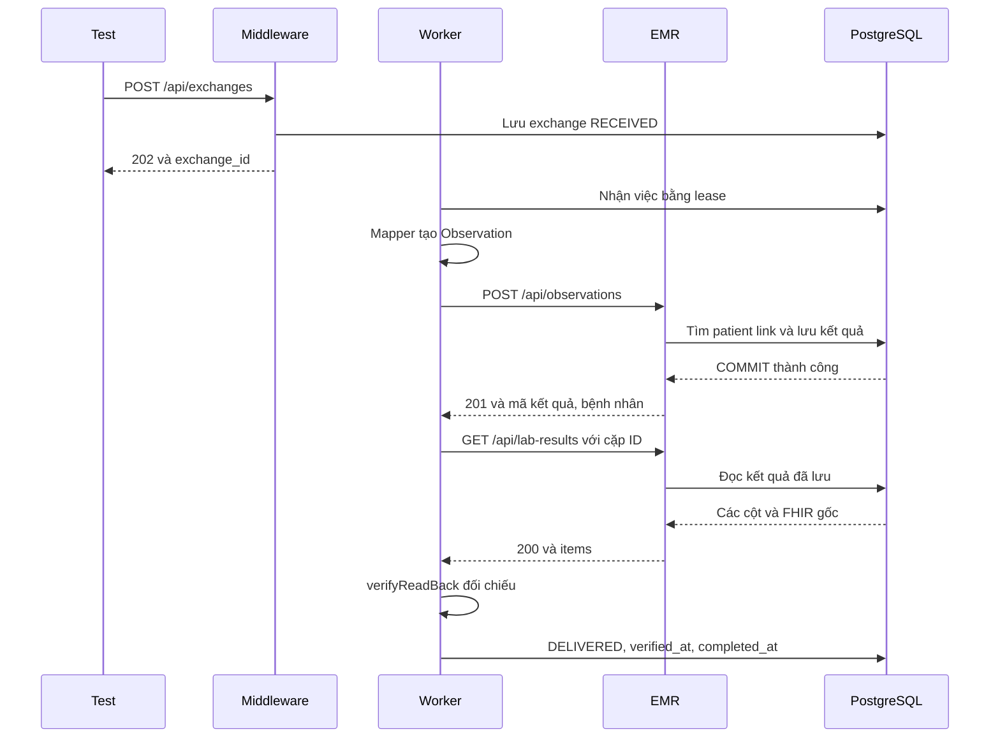

# SPP-66 C4 — Kiểm thử Middleware với EMR thật

**Kết quả: đạt phạm vi C4.** Middleware nhận gói xét nghiệm giả qua HTTP;
Worker/Mapper thật gửi sang EMR thật, EMR lưu vào PostgreSQL, Worker đọc lại
và chỉ ghi `DELIVERED` khi dữ liệu khớp. Bộ C4 có **16 test đạt**; chạy chung
với các bộ cũ có **386 test đạt, 0 lỗi, 0 bỏ qua**.

SPP-66 **chưa hoàn tất end-to-end**. LIS Dispatcher và việc ghi ACK tự động
phía LIS vẫn là phần riêng chưa triển khai. C4 dừng ở kiểm thử và báo cáo này.

## 1. Đã kiểm tra gì trước khi làm?

- Nhánh hiện tại: `main`; commit nền `0855212e07c8e7386a326ad514233b807b51d223`.
  Working tree có C1/C2/C3 chưa commit. Kết quả dưới đây áp dụng cho working
  tree có các thay đổi đó, không phải chỉ riêng commit nền.
- Đã đối chiếu Controller, Service, Repository và schema EMR với API contract;
  đọc Worker, Mapper, phần xác minh, cấu hình startup và các test B4B.
- C1/C2/C3 cung cấp đủ chức năng và dữ liệu cho Worker. Không phát hiện lỗi
  nghiệp vụ cần sửa; C4 không sửa code runtime của LIS/Middleware/EMR.
- Compose dùng PostgreSQL 17 và volume `postgres_data` cho môi trường phát
  triển. Khi preflight, Docker không có container đang chạy; image PostgreSQL
  17 đã có tại máy. Bộ test tạo container mới riêng, không dùng Compose hoặc
  dữ liệu phát triển.
- Test B4B dùng EMR giả lập được giữ nguyên. Bộ C4 nằm ở thư mục riêng để kết
  quả thật và kết quả giả lập không bị lẫn nhau.

## 2. Môi trường test và cách chạy lại

| Thành phần | Môi trường đã chạy |
|---|---|
| Node.js | `v26.12.0` |
| PostgreSQL | `17.11 (Debian 17.11-1.pgdg13+2)`, image `postgres:17` |
| Database | `dacn_db`, tạo mới từ DDL và `access_roles.sql` của repo |
| Lưu trữ | Container tên UUID riêng, dữ liệu trên tmpfs, không mount volume dự án |
| Kết nối | PostgreSQL và các HTTP server dùng cổng localhost tạm |
| Tài khoản | LIS: `lis_app`; Middleware/Worker: `integration_app`; EMR: `emr_app` |
| HTTP server | Express với Controller và parser thật, cùng cách đăng ký route như `main.ts` |
| Worker | `MiddlewareWorker` thật; có thêm test chạy `worker-main.ts` thành tiến trình riêng |

Runner tạo mật khẩu ngẫu nhiên mỗi lần chạy rồi truyền qua biến môi trường.
Không đọc hoặc sửa `.env`, không ghi mật khẩu vào source/báo cáo. Các kết nối
vẫn dùng tên cấu hình `LIS_DATABASE_URL`, `MIDDLEWARE_DATABASE_URL`,
`EMR_DATABASE_URL`; địa chỉ EMR đi qua cấu hình Worker hiện có.

Trước khi seed, test kiểm tra hai kết nối Middleware/EMR cùng trỏ tới container
local, đúng role, đúng database và đúng dấu nhận diện ngẫu nhiên do runner đặt
trong database mới. Các bảng test phải đang trống. Không khớp thì test dừng
trước khi ghi dữ liệu. Mỗi tình huống chỉ dọn các UUID/cặp ID nó tự tạo; cuối
suite kiểm tra không còn dữ liệu test. Runner tự dừng/xóa container của nó.

Từ `backend/`:

```bash
npm run check
npm run build

# Chỉ chạy C4 với PostgreSQL riêng:
npm run test:integration:postgres

# Chạy LIS, Middleware, EMR và C4 với PostgreSQL riêng:
npm run test:repositories:postgres
```

Lệnh cuối tự gọi lần lượt `npm test`, `npm run test:middleware`,
`npm run test:emr`, `npm run test:integration` trong môi trường test. Không cần
mở server phát triển. Chạy `test:integration` trực tiếp khi chưa có môi trường
cô lập sẽ báo **SKIP**, không phải bằng chứng PASS.

Runner in đường dẫn JSON bằng chứng trong thư mục tạm. Nó còn kiểm tra file
đó đã được tạo và suite đã chạy xong, tránh coi việc bỏ qua test là thành công.

## 3. Luồng test — giải thích dễ hiểu

Test chuẩn bị một bệnh nhân EMR giả và một mã bệnh nhân nguồn trỏ rõ tới người
đó. Sau đó nó đóng vai bên LIS gửi một gói xét nghiệm vào Middleware. Worker
thật tự lấy việc, đổi dữ liệu sang FHIR, gửi cho EMR, rồi hỏi EMR dữ liệu đã lưu.
Test đứng bên ngoài kiểm tra cả câu trả lời HTTP lẫn dữ liệu trong database.



Worker dùng `fetch` thật với `Content-Type: application/fhir+json`. EMR chạy
Controller C3 → Service C2 → Repository C1. Service kiểm tra Observation, tìm
liên kết bệnh nhân và quyết định lưu mới, trả bản cũ hay báo xung đột.
Repository ghi trong transaction; chỉ sau commit mới trả thành công.

Test không tự đặt trạng thái `DELIVERED`. Mọi chuyển trạng thái, attempt và
event đều do Worker/Repository thật tạo ra. Phần ghi nhận HTTP chỉ chép lại
request, status và JSON do Controller chọn, rồi gửi nguyên phản hồi đó.

**Vì sao phải đọc lại?** Câu trả lời `201` chỉ nói rằng EMR xác nhận đã lưu.
Worker vẫn phải kiểm tra tìm đúng một kết quả, đúng bệnh nhân, đúng mã, giá trị,
đơn vị, khoảng tham chiếu, thời gian và FHIR gốc. Khi tất cả khớp, Worker mới
lưu `DELIVERED`, `verified_at`, `completed_at` cùng một transaction.

## 4. Dữ liệu giả và đáp án độc lập

Nguồn là [c4-synthetic.json](../backend/tests/integration/fixtures/c4-synthetic.json),
viết tay riêng cho C4. File chứa snapshot nguồn, Observation mong đợi và các
cột EMR mong đợi. **Không lấy output Mapper làm đáp án duy nhất.** Test dùng
Mapper thật trong Worker, rồi so kết quả với đáp án này.

Mỗi lượt thêm UUID vào ID có tiền tố `C4-SYNTHETIC-`; số, đơn vị và thời gian
vẫn cố định để chạy lại được. SHA-256 fixture trong lần chạy đã ghi bằng chứng:

```text
4c25a29952fc599d684984ba1a72e4bbdae715a3b52502fbb5e612773d66839f
```

Mỗi tình huống có hai bệnh nhân giả cùng nhãn hiển thị. Mã nguồn trỏ tới bệnh
nhân đúng trong namespace quy định; một link khác cùng mã nhưng sai namespace
trỏ tới bệnh nhân còn lại. Nhờ vậy test phát hiện việc chọn nhầm người hoặc bỏ
qua namespace. Không đọc dataset SPP-65 và không ghi bảng thí nghiệm/evaluator.

Các giá trị dưới đây đã được so **bằng nhau chính xác**, không dùng sai số:

| Fixture | Cột mong đợi | Giá trị PostgreSQL và GET thực tế | Kết quả |
|---|---|---|---|
| Both | quantity `"0.30000000000000004"`; low `"0.1"`; high `"0.9"` | Đúng cả ba chuỗi | PASS |
| Low | quantity `"9007199254740991"`; low `"9007199254740990"`; high `null` | Đúng hai chuỗi và `null` | PASS |
| High | quantity `"0.000000123456789"`; low `null`; high `"0.0000002"` | Đúng hai chuỗi và `null` | PASS |
| None | quantity `"-12345.6789012345"`; low/high `null` | Đúng chuỗi và hai `null` | PASS |
| Both — thời gian | `2026-10-29T08:00:00.123456Z` | `2026-10-29T08:00:00.123456Z` | PASS |
| Low — thời gian | `2026-10-29T08:00:00.000001Z` | `2026-10-29T08:00:00.000001Z` | PASS |
| High — thời gian | `2026-10-29T08:00:00.999999Z` | `2026-10-29T08:00:00.999999Z` | PASS |
| None — thời gian | `2026-10-29T08:00:00.654321Z` | `2026-10-29T08:00:00.654321Z` | PASS |
| Bệnh nhân | UUID được seed cho link đúng | Khớp UUID đó, khác bệnh nhân mồi | PASS |
| Mã/tên/ngữ cảnh | `C4-LOCAL-TEST`, `C4 synthetic analyte`, `C4 synthetic analyte / Blood / Chemistry` | Khớp từng cột | PASS |
| Đơn vị/trạng thái | `mg/dL`, `final` | `mg/dL`, `final` | PASS |
| FHIR gốc | Toàn bộ Observation mong đợi, timestamp gốc `+07:00` | JSONB và GET giữ nguyên giá trị JSON | PASS |

## 5. Các trường hợp bắt buộc và kết quả

| Mã | Mong đợi | Thực tế đã chạy | Kết quả |
|---|---|---|---|
| C4-01 | POST 201, lưu một row, đọc đúng, DELIVERED | 4 fixture đều POST 201 → GET 200 → DELIVERED | PASS |
| C4-02 | Gửi lại cùng Observation trả 200, giữ UUID, không nhân bản | POST đầu 201; Worker gửi lại nhận ALREADY_EXISTS; toàn bộ row giữ nguyên | PASS |
| C4-03 | Thiếu link trả 422, không gắn nhầm bệnh nhân | PATIENT_NOT_LINKED; 0 row; Worker REJECTED và không GET | PASS |
| C4-04 | Cùng cặp nguồn, khác nội dung trả 409 | DUPLICATE_CONFLICT; row gốc giữ nguyên; Worker REJECTED | PASS |
| C4-05 | GET đúng cặp nguồn có đúng một row | HTTP và SQL cùng một row; sai namespace hoặc ID trả `items: []` | PASS |
| C4-06 | Số và thời gian không mất độ chính xác | Đúng các giá trị trong bảng trên, đủ sáu chữ số phần giây | PASS |
| C4-07 | SEND/VERIFY, counters, events và mốc hoàn tất khớp nhau | Lượt thành công có SEND 201 + VERIFY 200; hai mốc hoàn tất được lưu bằng nhau | PASS |
| C4-08 | Đọc sai hoặc đọc lỗi không được báo giao thành công | 5 mismatch thành FAILED; GET 503 vào RETRY_WAIT; khôi phục chỉ GET lại rồi DELIVERED | PASS |
| C4-09 | Các bộ LIS/Middleware/Mapper/Worker/EMR cũ vẫn đạt | LIS 79, Middleware 191, EMR 100; không bỏ qua test | PASS |
| C4-ENV | Các dịch vụ kết nối đúng role/schema | Ba `/ready` trả 200; script db-check cũng PASS cả ba | PASS |
| C4-PROCESS | Startup Worker thật hoạt động với EMR thật | `worker-main.ts` chạy riêng, giao thành công, SIGTERM thoát mã 0 | PASS |

Năm mismatch được tạo bằng cách sửa đúng bản ghi giả ngay trước GET thật:

- Quantity đổi thành `0.300000000000000040001`. Nếu ép sang JS number, số sai
  này trùng với số mong đợi; Worker vẫn phát hiện bằng chuỗi thập phân.
- Thời gian tăng đúng **1 microsecond**; Worker phát hiện sai `effective_at`.
- `patient_key` đổi sang bệnh nhân mồi; Worker phát hiện sai người.
- Subject identifier bên trong `fhir_json` bị đổi; Worker phát hiện FHIR sai.
- Row bị xóa; GET thật trả danh sách rỗng và Worker phát hiện thiếu kết quả.

Lỗi GET `503` được tạo bằng timestamp `infinity` trong bản ghi giả. PostgreSQL
cho lưu giá trị này nhưng Repository EMR thật từ chối trả nó như một instant
ISO hữu hạn. Sau khi trả timestamp đúng về, Worker chỉ thử lại VERIFY. Đây là
lỗi đọc dữ liệu thật qua backend, **không phải thử tắt PostgreSQL hoặc mất mạng**.

## 6. Một phần bằng chứng thực tế

Bản chụp đầy đủ: [JSON HTTP/SQL và audit](evidence/spp-66-c4.json).
Output chạy các test: [spp-66-c4-test-output.txt](evidence/spp-66-c4-test-output.txt).
Các bản chụp chỉ chứa dữ liệu giả và thông tin môi trường không có mật khẩu.

Ví dụ fixture `both` trong lần chạy cuối:

```text
exchange_id = f4d7cc61-2b77-4971-8a20-6c5ad62b7c37
external_id = C4-SYNTHETIC-R-270460d1-1190-49c7-ae0d-4f99dbd24f03
target_id   = 13a42df7-fe30-4005-aad4-7fb33f9fdfde
patient_key = af1a78a0-f901-41b1-8147-90bd8ed3a8ad
```

Worker nhận receipt từ POST thật:

```json
{
  "result": "STORED",
  "external_system": "https://example.org/lis/result",
  "external_id": "C4-SYNTHETIC-R-270460d1-1190-49c7-ae0d-4f99dbd24f03",
  "target_id": "13a42df7-fe30-4005-aad4-7fb33f9fdfde",
  "patient_key": "af1a78a0-f901-41b1-8147-90bd8ed3a8ad"
}
```

SQL đọc bằng kết nối `emr_app` riêng xác nhận một row; `quantity::text` là
`0.30000000000000004`; `effective_at` được định dạng UTC đủ microsecond thành
`2026-10-29T08:00:00.123456Z`. Toàn bộ `fhir_json` khớp fixture. GET của Worker
có cùng dữ liệu; `verifyReadBack` hiện có trả mảng lỗi rỗng.

Audit đã lưu:

```text
SEND   attempt 1 → HTTP 201, error_code = null
VERIFY attempt 1 → HTTP 200, error_code = null

RECEIVED → CLAIMED → VALIDATED → TRANSFORMED → SENT
→ TARGET_STORED → VERIFY_STARTED → DELIVERED

verified_at  = 2026-10-29T16:55:13.451Z
completed_at = 2026-10-29T16:55:13.451Z
```

Hai mốc audit trên là dạng JSON của trường thời gian Middleware. Test còn dùng
SQL kiểm tra trực tiếp `verified_at = completed_at`; việc giữ microsecond của
thời gian xét nghiệm được kiểm tra riêng như bảng ở mục 4.

## 7. Nếu thiếu liên kết hoặc phải thử lại thì sao?

Thiếu link đúng thì EMR trả `422/PATIENT_NOT_LINKED`, không tự đoán bệnh nhân
qua tên hoặc link sai namespace. Worker ghi một SEND lỗi với mã nội bộ
`REMOTE_VALIDATION_ERROR`, chuyển sang `REJECTED`, không có `verified_at` hoặc
`completed_at`. Mã lỗi EMR và mã nội bộ Worker khác nhau theo code B4B hiện có.

Gửi lại cùng dữ liệu và cùng cặp ID thì EMR trả `200/ALREADY_EXISTS` với
`target_id` cũ. Test C4-02 đã gửi một POST thật trước, rồi để Worker gửi lại;
kiểm tra toàn bộ row, kể cả thời điểm nhận/lưu, không đổi. Cách chống trùng này
là điều kiện để retry SEND an toàn.

Nếu đã xác nhận lưu mà GET lỗi, Worker nhớ mình đang ở VERIFY. Test đã quan
sát `POST 201 → GET 503 → GET 200`: số SEND vẫn là 1, số VERIFY thành 2.
Worker mới được tạo lại trước lượt GET tiếp theo vẫn dùng receipt đã lưu.
Gửi lại envelope LIS sau khi DELIVERED cũng không reset giao dịch hoặc audit.

## 8. Các helper để bạn dễ bảo trì

| Hàm / file | Công việc |
|---|---|
| `createFixture` — `c4-fixtures.ts` | Đọc đáp án viết tay; gắn ID mới; tạo envelope/hash bằng hàm LIS. Không gọi Mapper để tạo đáp án |
| `assertIsolated` — `c4-harness.ts` | Kiểm tra role/database/dấu nhận diện môi trường tạm trước khi seed |
| `createHarness` | Mở các HTTP app thật và kết nối test riêng; cấu hình Worker bằng URL thực tế |
| `scenario` | Seed hai bệnh nhân và link; POST vào Middleware; đăng ký dọn đúng các ID thuộc tình huống |
| `run` | Chạy một lượt Worker thật và thu lại đúng các HTTP request trong lượt đó |
| `dbRows` | SELECT qua kết nối riêng để so độc lập; giữ NUMERIC dạng chuỗi và timestamp đủ microsecond |
| `beforeRead` | Chạy một lần trước GET thật; dùng cho các phép sửa dữ liệu giả có chủ đích |
| `waitUntilDue` | Chờ giờ retry đã được Worker ghi trong DB; không sửa trạng thái hoặc ép lịch để báo thành công |
| `assertStored` — file suite | So đáp án với SQL, GET thật và `verifyReadBack`; kiểm tra đúng một row và đúng bệnh nhân |
| `assertAudit` | So counters/attempts/events với HTTP đã quan sát; kiểm tra mốc hoàn tất và không có DELIVERED giả |
| `record` | Lưu bằng chứng của tình huống sau khi các assertion đạt. PASS của test lỗi nghĩa là hệ thống đã từ chối đúng |

Các test dùng `node:test` và HTTP localhost giống quy ước hiện có; không thêm
thư viện test. EMR không được truyền dependencies giả. Worker dùng Repository
mặc định; không sửa hàm xác minh để làm test đạt.

## 9. Lệnh và kết quả đã chạy

| Lệnh | Kết quả thực tế |
|---|---|
| `npm run check` | PASS sau khi sửa hai lỗi kiểu/import trong code test mới |
| `npm run build` | PASS |
| `npm run test:integration:postgres` | 16 pass, 0 fail, 0 skip |
| `npm run test:repositories:postgres` | 386 pass, 0 fail, 0 skip |
| ↳ `npm test` | 79 pass |
| ↳ `npm run test:middleware` | 191 pass, gồm Mapper và Worker dùng EMR mock |
| ↳ `npm run test:emr` | 100 pass |
| ↳ `npm run test:integration` | 16 pass với EMR thật |
| `node ../scripts/db-check.mjs` trong C4 | PASS LIS, Middleware, EMR; các port do harness cấp |

Docker/socket localhost cần quyền thực thi ngoài sandbox; các lần chạy trên
đã thực thi với quyền đó. Không có test bị BLOCKED hoặc chưa chạy được trong
phạm vi C4. Node 26 có cảnh báo deprecation loader `tsx`, không làm test lỗi.
Container test đã được runner dọn sau khi chạy.

## 10. Phạm vi chưa được chứng minh và phần còn lại của SPP-66

- Chưa có LIS Dispatcher tự lấy sự kiện Publish để gửi và ghi ACK. C4 đóng
  vai bên gửi bằng fixture, nên chưa chứng minh toàn luồng tự động từ LIS.
- Không chạy bộ dữ liệu chính thức SPP-65 hoặc evaluator độc lập trên dữ liệu
  đó. Liên kết bệnh nhân chỉ được chứng minh với đáp án giả biết trước ở C4.
- Chưa chạy cả hệ thống bằng Docker Compose, nhiều máy, TLS, kiểm thử tải hoặc
  vận hành dài hạn. HTTP app Middleware/EMR chạy trong harness; Worker có một
  tình huống chạy startup riêng.
- C4-02 chứng minh gửi lặp vào EMR đã có kết quả. Tình huống mất phản hồi ngay
  sau commit, nhiều Worker tranh việc và toàn bộ retry budget vẫn có bằng
  chứng ở test B4B với EMR giả lập; C4 không biến các kết quả đó thành bằng
  chứng EMR thật.
- Nhánh GET 503 dùng dữ liệu timestamp có chủ đích để gây lỗi đọc thật; chưa
  kiểm thử mất kết nối PostgreSQL từ xa hoặc dừng máy chủ database.

Các file C4 thêm/sửa: `backend/tests/integration/` (suite, harness, fixture
helper và JSON), `backend/package.json`, `scripts/test-repositories-postgres.mjs`,
`docs/api-contract.md`, `docs/architecture.md`, tài liệu này và hai file bằng
chứng trong `docs/evidence/`. Các thay đổi C1/C2/C3 có sẵn được giữ lại.

Dừng ở C4 để review. Chưa commit, push hoặc mở pull request.
