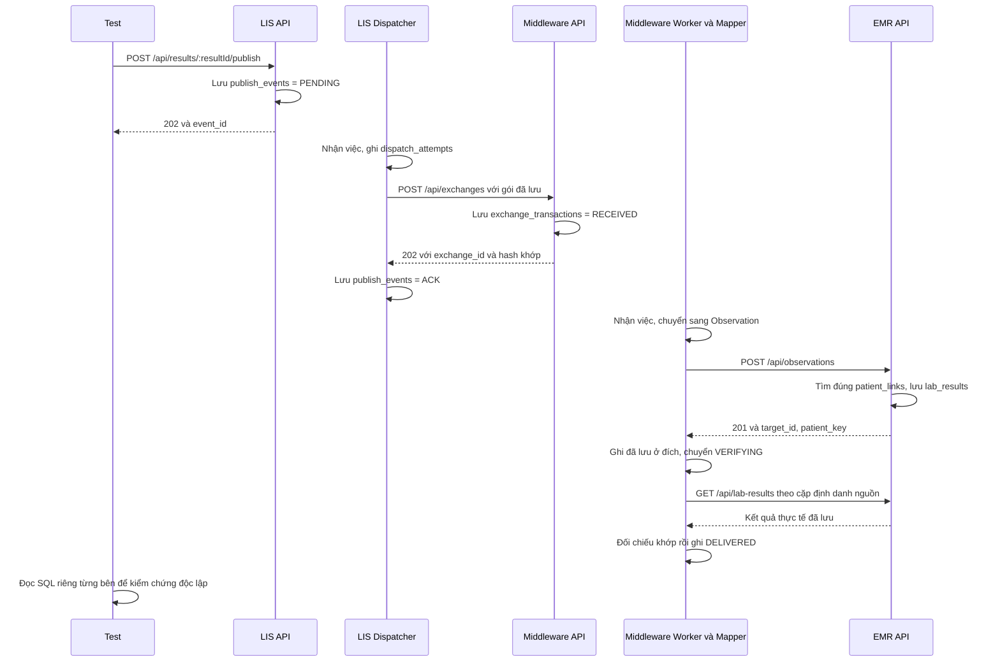

# SPP-66 D3 — Kiểm thử toàn luồng LIS → Middleware → EMR

**D3 đã chạy đạt: 15 test, 0 lỗi, 0 bỏ qua.** Chạy chung với các bộ cũ được
**495 test đạt**. Lần này bắt đầu bằng API Publish thật của LIS, đi qua
Dispatcher, Middleware, Worker/Mapper, rồi tới EMR và đọc lại kết quả đã lưu.

Các thành phần và PostgreSQL đều chạy thật. **Dữ liệu vẫn là dữ liệu giả tự
viết cho test**, chưa phải kiểm thử bằng MIMIC hoặc bộ SPP-65 chính thức.

## 1. Đã kiểm tra gì trước khi làm?

Đã đọc working tree, hợp đồng API, kiến trúc, review C4/D1/D2, code xử lý của
ba dịch vụ, cách khởi động Dispatcher/Worker và runner PostgreSQL hiện có.
D1/D2 đã có; lượt đối chiếu trước D3 chạy riêng D1/D2 được **94 đạt, không bỏ
qua**. Năm nhóm `skip` khi chạy `npm test` thiếu database đã được giải thích
trong [review D2, mục 8](spp-66-d2-review.md#8-kiểm-thử-và-bằng-chứng).

Working tree đã có các thay đổi C1–C4/D1/D2 chưa commit; D3 giữ lại chúng.
Không thấy lỗi nghiệp vụ cần sửa để hoàn thành D3. Phần mới nằm trong test,
runner và tài liệu; không sửa thuật toán Publish, Dispatcher, Mapper hay EMR.

## 2. Một kết quả xét nghiệm đi qua hệ thống như thế nào?

Hãy tưởng tượng LIS có kết quả R1 đã duyệt xong. Publish tạo một “phiếu cần
gửi” chứa bản chụp R1. Dispatcher mang phiếu này tới Middleware. Middleware
cất phiếu rồi xác nhận đã nhận. Worker tiếp tục đổi dữ liệu sang Observation
— bản JSON chứa kết quả xét nghiệm theo định dạng FHIR của dự án — rồi gửi EMR.
Sau cùng, Worker hỏi EMR đọc lại để chắc rằng kết quả đã được lưu đúng.



Sơ đồ mô tả lượt thành công thông thường. Worker và Dispatcher chạy độc lập:
nếu phản hồi về LIS bị mất, Worker vẫn có thể giao xong trước khi LIS ghi ACK.
D3-05 kiểm tra chính tình huống đó.

| Ai thực hiện? | Gọi gì/làm gì? | Bảng liên quan |
|---|---|---|
| Test chuẩn bị dữ liệu | Thêm kết quả FINAL, danh mục và bệnh nhân giả | `lis.results`, `lis.test_catalog`, `lis.patients`, `emr.patients`, `emr.patient_links` |
| Test gọi LIS | `POST /api/results/:resultId/publish` | LIS lưu `lis.publish_events`, gồm snapshot/hash |
| Dispatcher | `POST /api/exchanges` | LIS ghi `lis.dispatch_attempts`; Middleware lưu `integration.exchange_transactions` và `exchange_events` |
| Dispatcher nhận xác nhận | Kiểm tra đủ định danh/hash rồi ghi ACK | `lis.publish_events`, `lis.dispatch_attempts` |
| Worker gọi Mapper rồi EMR | `POST /api/observations`, kiểu nội dung `application/fhir+json` | Middleware lưu FHIR và lịch sử; EMR tra `patient_links`, ghi `emr.lab_results` |
| Worker hỏi lại EMR | `GET /api/lab-results?external_system=...&external_id=...` | EMR đọc `lab_results`; Middleware cập nhật lịch sử và `DELIVERED` |

Trong Middleware, `exchange_attempts` ghi từng lần SEND/VERIFY;
`exchange_events` ghi các bước đã xảy ra. Ba dịch vụ vẫn chỉ trao đổi qua HTTP.
Test có ba kết nối riêng để đọc kiểm chứng, mỗi kết nối dùng đúng quyền của
dịch vụ đó, không dùng quyền quản trị để đọc thay.

## 3. ACK, DELIVERED và gửi lại khác nhau ra sao?

**ACK:** LIS biết Middleware đã cất gói dữ liệu và trả đúng xác nhận.
**DELIVERED:** Worker đã gửi EMR, đọc lại qua HTTP và thấy dữ liệu khớp.
Vì vậy LIS ACK chưa đủ kết luận EMR lưu thành công. D3-06 có LIS ACK nhưng
Middleware REJECTED vì không tìm thấy liên kết bệnh nhân đúng.

D3-10 còn giữ lại phản hồi GET thật của EMR. Lúc đó EMR đã có một kết quả,
nhưng Worker chưa nhận được dữ liệu đọc lại: trạng thái vẫn là `VERIFYING`,
chưa có `verified_at`/`completed_at` và chưa có sự kiện `DELIVERED`. Chỉ khi
thả phản hồi và Worker đối chiếu xong, các mốc hoàn tất mới xuất hiện.

**Publish lần đầu** tạo phiếu gửi. **Bấm Publish lại cùng kết quả** trả phiếu
cũ, không tạo phiếu mới. **Retry** là Dispatcher gửi lại chính phiếu đang có
do lần trước gặp lỗi; tăng số lượt thử, giữ nguyên `event_id`, snapshot, hash
và thời điểm Publish. Nó không đọc lại nguồn để tạo nội dung khác.

Trong D3-05, Middleware đã lưu nhưng đường truyền làm mất phản hồi. LIS chưa
ACK và phải thử lại. Test cho Worker giao xong trước, rồi mới cho LIS gửi lại:
Middleware trả `exchange_id` ban đầu, giữ nguyên trạng thái DELIVERED và toàn
bộ lịch sử. EMR vẫn chỉ có một kết quả.

## 4. Môi trường và đáp án đối chiếu

Runner tạo **một container PostgreSQL mới**, database `dacn_db` với ba schema
`lis`, `integration`, `emr`, giống cách tổ chức của dự án. Khởi tạo bằng đúng
`database/dacn_db_init_v2.sql` và `database/access_roles.sql`. Ba tài khoản
`lis_app`, `integration_app`, `emr_app` được cấp mật khẩu ngẫu nhiên cho lượt
test. Không dùng hoặc xóa volume phát triển.

Trước khi ghi dữ liệu hay chạy Worker, harness kiểm tra host `127.0.0.1`,
port riêng, tên database/tài khoản, dấu nhận diện ngẫu nhiên do runner tạo và
11 bảng phải trống. Thiếu điều kiện thì dừng. Sau mỗi tình huống chỉ xóa dữ
liệu có ID của tình huống đó; cuối bộ test kiểm tra lại các bảng trống. Runner
dừng và xóa container dù test thành công hay thất bại.

Ba ứng dụng dùng Express, bộ đọc JSON và hàm đăng ký route như code khởi động
thật, không truyền Service/Repository giả. D3-01 chạy cả `dispatcher-main.ts`
và `worker-main.ts` thành tiến trình riêng; dừng bằng SIGTERM, mã thoát 0.
D3-08 tắt Dispatcher bằng SIGKILL rồi khởi động tiến trình mới. Các ca còn lại
gọi `runOnce()` của Dispatcher/Worker thật để kiểm soát lúc bắt đầu từng bước.

Có một lớp chuyển tiếp HTTP phục vụ ghi bằng chứng và gây lỗi mạng. Nó chỉ
chuyển tiếp status/body thật; có thể ngắt hoặc giữ phản hồi sau khi phía nhận
đã xử lý xong. D3-04 tắt listener Middleware thật rồi bật lại cùng port.
Không dựng API giả để trả ACK, Observation hoặc dữ liệu đọc lại.

Đáp án nằm trong [d3-synthetic.json](../backend/tests/e2e/fixtures/d3-synthetic.json),
được viết trước khi chạy: gồm dữ liệu LIS, Observation mong đợi và các cột EMR
mong đợi. Test không lấy kết quả Mapper làm đáp án. ID thêm UUID để các lượt
không đụng nhau; giá trị xét nghiệm, đơn vị, thời gian và cận vẫn cố định.

| Biến thể | Giá trị mong đợi | Cận dưới | Cận trên | Phần giây cần giữ |
|---|---|---|---|---|
| `both` | `0.30000000000000004` | `0.1` | `0.9` | `.123456` |
| `low` | `9007199254740991` | `9007199254740990` | Không có | `.000001` |
| `high` | `0.000000123456789` | Không có | `0.0000002` | `.999999` |
| `none` | `-12345.6789012345` | Không có | Không có | `.654321` |

Đây là các số cố ý chọn để thử độ chính xác, không diễn giải lâm sàng. Cả bốn
dùng `mg/dL`; thời gian nguồn 15:00 ở `+07:00` phải thành 08:00 UTC cùng ngày.
NUMERIC được đọc thành chuỗi và thời gian đọc đủ sáu chữ số phần giây để tránh
làm tròn trong chính bài test. Không có cận nào thì Observation phải bỏ
`referenceRange`, không để một phần tử rỗng.

Test tự tạo bệnh nhân đúng và bệnh nhân gây nhầm. Có cả liên kết trùng ID
nhưng khác hệ định danh, và cùng hệ định danh nhưng khác ID. Sau khi EMR lưu,
test đọc `patient_key`, tra lại bệnh nhân đã tạo từ đầu và kiểm tra nhãn đúng.
Ca thiếu liên kết đúng phải từ chối, không được chọn nhầm các liên kết còn lại.

## 5. Kết quả từng tình huống bắt buộc

| Mã | Đã thực sự kiểm tra | Kết quả |
|---|---|---|
| D3-01 | Publish thật → PENDING → tiến trình Dispatcher ghi ACK → tiến trình Worker giao/đọc lại → DELIVERED; đúng một kết quả EMR | Đạt |
| D3-02 | Publish lại trước và sau khi giao; cùng event_id, không đổi lịch sử hoặc nhân bản kết quả | Đạt |
| D3-03 | Middleware đã nhận một lần; Dispatcher gửi lại đúng gói và LIS lưu exchange_id ban đầu | Đạt |
| D3-04 | Tắt Middleware thật; LIS RETRY_WAIT, chưa ACK, chưa có exchange; bật lại và đợi lịch thật thì giao thành công | Đạt |
| D3-05 | Bỏ phản hồi 202 thật sau khi lưu; gửi lại cùng byte dữ liệu, không tạo thêm exchange và không reset giao dịch đã DELIVERED | Đạt |
| D3-06 | Thiếu liên kết bệnh nhân đúng; EMR trả 422, không lưu kết quả, Middleware REJECTED, không GET hoặc DELIVERED | Đạt |
| D3-07 | Hai Dispatcher thật cạnh tranh cùng lúc; một bên nhận việc, một bên không có việc; một lượt gửi, một exchange, một kết quả | Đạt |
| D3-08 | SIGKILL lúc chờ ACK đã bị giữ lại; đợi quyền xử lý tạm hết hạn bằng đồng hồ PostgreSQL; tiến trình mới tiếp tục, giữ exchange_id | Đạt |
| D3-09 | Bốn biến thể cận; kiểm tra số, đơn vị, mã/tên/ngữ cảnh xét nghiệm, bệnh nhân, thời gian và toàn bộ FHIR bằng đáp án riêng | Cả 4 đạt |
| D3-10 | Đọc lịch sử độc lập; các mốc đúng thứ tự; giữ phản hồi GET để chứng minh chưa được DELIVERED sớm | Đạt |

D3-08 giữ lịch sử lượt 1 với lỗi `LEASE_EXPIRED`, thêm lượt 2 thành công và đổi
mã giữ quyền xử lý. Test không sửa trạng thái hoặc thời hạn trong SQL để giả
lập khởi động lại. Các ca gửi lại đều kiểm tra snapshot/hash/thời điểm Publish
không đổi; D3-04/05/08 còn so sánh nguyên byte body gửi trước và sau lỗi.

Ở mỗi lượt thành công, lịch sử Middleware phải là:
`RECEIVED → CLAIMED → VALIDATED → TRANSFORMED → SENT → TARGET_STORED → VERIFY_STARTED → DELIVERED`.
Có đúng một lượt SEND trả 201 và một lượt VERIFY trả 200. Test so sánh cả thứ tự
thời gian giữa các bảng và các hệ thống, không chỉ tên trạng thái cuối cùng.

## 6. Chạy lại và hiểu đúng số test

Cần Docker hoạt động và image `postgres:17` đã có trên máy; runner không tự
tải image. Tại thư mục dự án:

```bash
cd backend
npm run check
npm run build

# Chỉ D3, tự dựng database và HTTP tạm:
npm run test:e2e:postgres

# Toàn bộ LIS, Middleware, EMR, C4 và D3:
npm run test:repositories:postgres
```

Không cần bật API/Dispatcher/Worker bằng tay hoặc điền URL database phát triển.
Runner tự cấp kết nối test và chạy lần lượt các lệnh bên dưới.

| Lệnh đã chạy | Kết quả thực tế |
|---|---|
| `npm run check` | Đạt kiểm tra TypeScript source và tests |
| `npm run build` | Đạt |
| `npm test` trong runner PostgreSQL | 173 đạt, 0 lỗi, 0 bỏ qua |
| `npm run test:middleware` trong runner | 191 đạt, 0 lỗi, 0 bỏ qua |
| `npm run test:emr` trong runner | 100 đạt, 0 lỗi, 0 bỏ qua |
| `npm run test:integration` trong runner | 16 đạt, 0 lỗi, 0 bỏ qua |
| `npm run test:e2e` trong runner | 15 đạt, 0 lỗi, 0 bỏ qua |
| `npm run test:e2e:postgres` riêng | 15 đạt, 0 lỗi, 0 bỏ qua |

Tổng lượt chung: **173 + 191 + 100 + 16 + 15 = 495**. Bộ D3 gồm 13 tình huống
nghiệp vụ (D3-09 có bốn biến thể), một kiểm tra môi trường và một test cha;
Node đếm cả test cha nên báo 15. Không cộng lượt chạy riêng lần nữa vào 495.
Các số 480 trong review D2 là kết quả trước khi thêm D3.

Môi trường chạy ngày **2026-10-30**: Node `v26.12.0`, PostgreSQL
`17.11 (Debian 17.11-1.pgdg13+2)`, image `postgres:17`, HTTP localhost với port
ngẫu nhiên. Cấu hình test thường dùng timeout 3 giây, quyền xử lý 15 giây,
nhịp kiểm tra 20 ms, chờ thử lại 500/1000 ms; Dispatcher tối đa 3 lượt. D3-08
dùng timeout 1 giây và quyền xử lý 2,5 giây để thử khởi động lại. Đây là cấu
hình riêng của test, không đổi mặc định chạy ứng dụng.

Đã thử lệnh `env -u D3_DATABASE_ISOLATION_TOKEN npm run test:e2e`: thoát mã 1
với thông báo yêu cầu `npm run test:e2e:postgres`, trước khi kết nối/ghi database.
Đây là **lượt cố ý kiểm tra việc từ chối cấu hình thiếu**, không tính vào 495
test đạt. `test:e2e` không âm thầm bỏ qua cả bộ khi thiếu môi trường.

Các lượt chạy có kết quả assertion được thực hiện với quyền HTTP localhost và
Docker. Lần thử guard trong sandbox chỉ báo lỗi cấp file nên không dùng làm
bằng chứng; đã chạy lại ngoài sandbox và thấy đúng assertion từ chối cấu hình.
Không còn ca D3 bị chặn. Node có cảnh báo loader `tsx` dùng API đã cũ; cảnh báo
không làm các lượt test trên thất bại. Đã xác nhận container test được dọn sạch.

## 7. Bằng chứng và file thay đổi

- [Bằng chứng JSON](evidence/spp-66-d3.json): 13 tình huống, nguồn ban đầu,
  đáp án riêng, event/hash, ACK và lịch sử LIS, exchange/audit/FHIR Middleware,
  kết quả EMR, bệnh nhân đúng, request/response HTTP và đối chiếu đọc lại.
- [Log lượt chung 495 test](evidence/spp-66-d3-test-output.txt).
- [Log kiểm tra từ chối thiếu cấu hình](evidence/spp-66-d3-guard-output.txt).

Ví dụ D3-01 trong JSON đã lưu:

```text
event_id    = 462703cf-f5e3-4358-a509-8f7f16151a61
source_hash = 32f037de4244ddf3f7887986c4ba62cbb0417d0e71ecd5a0704a6ac423eceb9e
exchange_id = 719a5b06-92e5-408d-840b-2a5bdc372320
target_id   = cc19a89d-218e-4097-ad98-b32b6f385381
patient_key = 0518b9a8-19bb-4d01-9843-3479fefea904
LIS = ACK; Middleware = DELIVERED; EMR = 1 kết quả đúng bệnh nhân
```

Mỗi lượt chạy sẽ có ID và thời điểm khác. JSON ghi Node/PostgreSQL, cấu hình,
hash file fixture/DDL/quyền truy cập để đối chiếu. Không ghi mật khẩu hoặc URL
database; mã giữ quyền xử lý tạm được che. Tất cả ID/nhãn bệnh nhân là giả.

File chính: [suite D3](../backend/tests/e2e/lis-emr.e2e.test.ts),
[harness](../backend/tests/e2e/d3-harness.ts),
[chuyển tiếp HTTP](../backend/tests/e2e/d3-network.ts),
[đọc fixture/đáp án](../backend/tests/e2e/d3-fixtures.ts).
`backend/package.json` thêm hai lệnh E2E; runner PostgreSQL thêm D3 vào lượt
chung và kiểm tra bằng chứng đủ cả mười mã bắt buộc trước khi báo thành công.

## 8. D3 chứng minh được gì, chưa chứng minh được gì?

D3 chứng minh luồng backend thật hoạt động với các dữ liệu và lỗi đã liệt kê:
từ Publish tới đọc lại EMR, giữ đúng nội dung/bệnh nhân, tránh tạo trùng khi
gửi lại, phục hồi sau ngắt Dispatcher và không báo hoàn tất quá sớm.

Chưa chạy MIMIC/SPP-65 chính thức, frontend hoặc evaluator. Chưa kiểm thử
triển khai cả hệ thống bằng Compose, nhiều máy, tải lớn, TLS, mất PostgreSQL
hay mọi kiểu lỗi mạng. Thứ tự thời gian xuyên hệ thống được kiểm tra trên cùng
một PostgreSQL test; chưa chứng minh đồng hồ của các máy độc lập đồng bộ.
Observation được đối chiếu theo hợp đồng FHIR hiện tại của dự án, chưa chạy
bộ xác thực FHIR bên ngoài hoặc mọi loại xét nghiệm.

Dừng sau D3 để bạn review. Chưa làm D4, chưa commit, push hay đổi trạng thái Jira.

## 9. Năm câu hỏi tự kiểm tra

1. LIS đã ACK nhưng EMR thiếu liên kết bệnh nhân thì Middleware có được DELIVERED không?
2. Middleware đã lưu mà phản hồi bị mất: lần gửi lại phải giữ những thông tin nào?
3. Vì sao thấy EMR trả 201 vẫn cần gọi GET đọc lại?
4. Dispatcher bị tắt giữa chừng: vì sao tiến trình mới phải đợi quyền xử lý cũ hết hạn?
5. D3 dùng ứng dụng và PostgreSQL thật; điều đó có đồng nghĩa đã kiểm thử MIMIC thật không?
