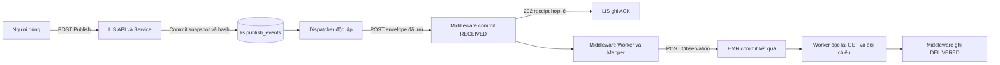

# DACN – Khảo sát và phương án Publish LIS Giai đoạn 2.3

Ngày 04/11/2026, Asia/Bangkok. Nhánh `feature/frontend/lis-emr-ui`; HEAD `1fcd46af6582921db6ac2b477f8014d649dfb0c3`, `feat(lis): complete result detail and search UX phase 2.2`.

**Chỉ khảo sát, chưa triển khai.** Lần này chỉ tạo báo cáo này; không sửa mã nguồn/backend/database/Compose/dependency, không gọi Publish trên hệ thống thật, không stage/commit/push/merge và không ghi đè bằng chứng 2.1/2.2.

## 1. Kiến trúc Publish thực tế và phạm vi xác minh

### Nguồn đối chiếu

Đã đọc [Controller LIS](../backend/src/lis/controller.ts), [Service](../backend/src/lis/service.ts), [Repository](../backend/src/lis/repository.ts), [schema Drizzle](../backend/src/lis/schema.ts), [DDL PostgreSQL](../database/dacn_db_init_v2.sql), quyền database; Dispatcher/config/entry point; Controller/Service/Repository/Worker middleware; các test HTTP, PostgreSQL và E2E D3; frontend LIS, proxy dev/preview và Monitor.

Đã đọc hai PDF tại `C:/Users/NGOC TU/Downloads/`:

| Tệp | Phiên bản bên trong | Phần đối chiếu chính |
|---|---|---|
| `20261012_Implementation_DACN_v2.pdf` | Kế hoạch 1.1, 12/10/2026 | §4.1–4.3; §9.1–9.7, trang in 21–25 |
| `Ke_hoach_thuc_nghiem_LIS_FHIR_EMR (1).pdf` | Kế hoạch 1.0, 01/10/2026 | §9, trang in 15–16; §10.3–10.4, trang in 18 |

SHA-256 lần lượt: `238b46d66712e460bd992f23925b83ceb622f587c7df597eb29f3df95fe19ac6`; `56a4a8188a79e0fb695222a2bd48a17c6de6bbd44c62f2edb3beb5e8bbdf3dc2`.

### Luồng thực tế



Nhánh ghi ACK và nhánh xử lý tới EMR độc lập: mất receipt có thể khiến middleware đã DELIVERED trong khi LIS còn RETRY_WAIT. Không bắt buộc ACK xuất hiện trước DELIVERED.

Publish chỉ chốt yêu cầu gửi, không gửi ngay tới middleware. Service tìm event cũ trước. Nếu chưa có: đọc kết quả/bệnh nhân/catalog dưới `FOR SHARE`, đọc lại trạng thái sau khi chờ khóa, kiểm dữ liệu, tạo UUID/snapshot/hash SHA-256 rồi lưu trong cùng transaction `READ COMMITTED`. Kiểm event lần nữa để xử lý publisher cạnh tranh. `UNIQUE(result_id)` và `ON CONFLICT DO NOTHING` khiến yêu cầu thua lấy lại event thắng, không ghi đè.

Tạo mới cần: FINAL; mã/tên không rỗng; quan hệ bệnh nhân/catalog đúng; accepted_units là mảng chuỗi hợp lệ; unit khớp chính xác; số và hai cận chuyển sang JSON number không mất giá trị; low ≤ high khi đủ hai cận; thời gian hữu hạn UTC năm 0001–9999 với sáu chữ số phần lẻ. **FINAL là điều kiện cần, chưa đủ.** GET kết quả không trả accepted_units nên UI không thể kiểm toàn bộ thay backend. Snapshot gồm 12 trường kết quả; source_system cố định `lis-demo`.

### Lưu trữ và Dispatcher

`lis.publish_events`: event_id UUID PK; result_id FK và UNIQUE; source_system/source_snapshot JSONB/source_hash/published_at; exchange_id; dispatch_status/dispatch_attempt_count/next_retry_at; lease_until/lease_token; acked_at/ack_response; last_error_code/message. ACK phải có exchange_id/acked_at/ack_response. exchange_id không có FK xuyên schema.

`lis.dispatch_attempts`: từng lần thử, UNIQUE(event_id, attempt_no), token, các mốc thời gian, HTTP status và lỗi. Snapshot được luồng Publish giữ nguyên; **không có trigger bất biến hoặc đối chiếu nguồn mới khi Publish lặp**. Role LIS vẫn có UPDATE trên schema LIS.

Dispatcher nhận PENDING, RETRY_WAIT đến hạn hoặc IN_FLIGHT hết lease bằng `FOR UPDATE SKIP LOCKED`; bỏ qua ACK/BLOCKED/FAILED. Claim và begin-attempt là hai transaction riêng. Begin-attempt ghi bộ đếm/attempt trước HTTP; mark-sent ghi ranh giới gửi; finish kiểm lease/token và commit attempt cùng trạng thái event. Không giữ transaction chờ mạng; tiến trình cũ không ghi đè chủ mới.

Mặc định source/Compose: poll 1 giây, timeout 3 giây, lease 15 giây, tối đa 4 lần thử với chờ 2/4/8 giây. Chưa đọc override môi trường container; không coi mặc định là cấu hình đo đã chốt.

| Kết quả gửi tới middleware | Xử lý LIS |
|---|---|
| 202, receipt đủ và khớp định danh/hash | ACK, lưu exchange_id/receipt |
| 202 thiếu/sai receipt, JSON/media type sai | FAILED / INVALID_ACK |
| Mạng/timeout | RETRY_WAIT / NETWORK_ERROR hoặc HTTP_TIMEOUT; hết lượt thì FAILED |
| 408/429/5xx | RETRY_WAIT / HTTP_TEMPORARY; hết lượt thì FAILED |
| 409 | BLOCKED / DUPLICATE_CONFLICT |
| 400/413/415/422 | BLOCKED / REMOTE_VALIDATION_ERROR |
| 4xx khác | BLOCKED / HTTP_PERMANENT |
| 2xx khác 202, redirect và phản hồi không chấp nhận khác | FAILED / HTTP_PERMANENT |
| Envelope đã lưu sai | BLOCKED / VALIDATION_ERROR, không tự sửa |

Persistence còn dùng RETRY_EXHAUSTED khi begin-attempt thấy hết ngân sách; attempt hết lease ghi LEASE_EXPIRED. Lỗi ở lần gửi cuối có thể giữ mã nguyên nhân như HTTP_TEMPORARY thay vì RETRY_EXHAUSTED. Không suy mọi FAILED đều cùng nguyên nhân.

### Kiểm chứng mới và bằng chứng lịch sử

Đã chạy ba bộ sẵn có trong container hiện hữu, dependency giả lập, không dùng database thật:

```text
docker exec lis-fhir-emr-lis-1 node --import tsx --test --test-concurrency=1
  tests/lis/controller.http.test.ts
  tests/lis/dispatcher.unit.test.ts
  tests/middleware/controller.http.test.ts

77 tests, 77 pass, 0 fail, 0 skipped
```

Đây là một lệnh với ba file test. Các test xóa cấu hình database trong tiến trình riêng và dùng dependency giả lập; POST chỉ tới server kiểm thử tạm. Hash chuẩn hóa newline của sáu file source và ba file test liên quan trong container khớp checkout.

GET trên backend thật:

| GET | Quan sát |
|---|---|
| LIS `/ready`, middleware `/ready` | 200, database ready |
| LIS `/api/results/MIMIC-LAB-100145` | 200, Potassium, FINAL, 3.6 mEq/L |
| LIS `/docs/api/openapi.json` | Đúng sáu route LIS đã đọc trong source |
| LIS `/api/publish-events/not-a-uuid` | 400 VALIDATION_ERROR |
| LIS `/api/publish-events/00000000-0000-4000-8000-000000000000` | 404 NOT_FOUND, Publish event not found |
| LIS `/api/publish-events?result_id=MIMIC-LAB-100145` | 404 NOT_FOUND, API route not found |
| Middleware `/api/exchanges?limit=1` và lọc mã kết quả trên | 200, danh sách rỗng |

`docker ps` xác nhận LIS, Dispatcher, middleware, Worker, EMR và PostgreSQL đang chạy; không bật/tắt chúng. Chưa có exchange để tra một event thật trong lần khảo sát; không suy middleware rỗng nghĩa là outbox LIS chưa có event.

Không chạy lại test PostgreSQL/E2E vì chúng thêm/sửa/dọn dữ liệu. [D3 test output đã lưu](docs_backend/evidence/spp-66-d3-test-output.txt) có D3 đạt 15/15, gồm Publish lặp, mất ACK, restart và giữ VERIFYING trước khi GET trả về. Đây là bằng chứng lịch sử, không phải lượt E2E mới ngày khảo sát.

## 2. API Publish đầy đủ

### API LIS

Backend hiện tại `http://127.0.0.1:3101`; frontend dùng `/api/lis/...`, proxy chuyển thành `/api/...`.

| API | Path/query/body | Thành công | Lỗi thực tế | Điều kiện và gọi lặp |
|---|---|---|---|---|
| **POST `/api/results/:resultId/publish`** | Path: định danh không rỗng, không chỉ khoảng trắng, không control; giữ ký tự/hoa thường. Không cần body. JSON nếu có bị bỏ qua nghiệp vụ, không thay ID path. Query không có ý nghĩa, controller hiện bỏ qua query thừa. | 202 tạo mới; 200 event đã có; cùng JSON bốn trường. | 400 VALIDATION_ERROR; 404 NOT_FOUND; 422 RESULT_NOT_READY / INVALID_TEST_CODE / INVALID_UNIT / VALIDATION_ERROR; 503 DEPENDENCY_UNAVAILABLE. Parser thêm 413/415 VALIDATION_ERROR. **Không có nhánh 409.** | Tạo mới cần FINAL hợp lệ. Event đã có thì trả trước kiểm nguồn, kể cả nguồn hiện READY/đã đổi; không reset trạng thái/ngân sách. |
| **GET `/api/publish-events/:eventId`** | UUID path 8-4-4-4-12, nhận chữ hoa/thường. Không cần body/query; query thừa hiện bỏ qua. | 200: JSON bảy trường. | 400 VALIDATION_ERROR; 404 NOT_FOUND; 503 DEPENDENCY_UNAVAILABLE. | Cần biết event_id; nguồn không cần hiện FINAL. Gọi lặp chỉ đọc, không thêm attempt hoặc retry. |

POST 202, UUID minh họa:

```json
{
  "event_id": "00000000-0000-4000-8000-000000000001",
  "result_id": "MIMIC-LAB-100145",
  "dispatch_status": "PENDING",
  "exchange_id": null
}
```

POST 200 có cùng bốn trường nhưng trạng thái là event đã lưu, có thể ACK/BLOCKED/FAILED; không buộc PENDING. 200 không có nghĩa gửi lại hoặc EMR đã lưu.

GET event ví dụ:

```json
{
  "event_id": "00000000-0000-4000-8000-000000000001",
  "result_id": "MIMIC-LAB-100145",
  "dispatch_status": "RETRY_WAIT",
  "exchange_id": null,
  "dispatch_attempt_count": 1,
  "last_error_code": "HTTP_TEMPORARY",
  "last_error_message": "The latest dispatch attempt failed."
}
```

Chưa có lỗi thì last_error_code/message là null. Controller đổi mã lỗi không an toàn thành DISPATCH_ERROR và không trả thông điệp thô. GET không trả snapshot/hash/published_at/next_retry_at/acked_at hay lịch sử attempt.

Lỗi chung:

```json
{"error":{"code":"RESULT_NOT_READY","message":"Only FINAL results can be published"}}
```

`field` có trong outcome service nhưng không có trong JSON controller. 404 phân biệt message Laboratory result not found / Publish event not found / API route not found. Backend chưa có authentication/authorization HTTP; bật nút không phải kiểm quyền.

**Không có API HTTP LIS tra event theo result_id, liệt kê event, đọc dispatch_attempts hoặc retry/requeue.** Repository có getPublishEventByResultId, chưa expose route. Không suy endpoint từ tên hàm.

### Middleware liên quan

Backend `http://127.0.0.1:3102`; proxy frontend có sẵn `/api/middleware` tới `/api`.

| API | Request | Status/error | Gọi lặp/điều kiện |
|---|---|---|---|
| **POST `/api/exchanges`** | Dispatcher gọi; không path/query, query bất kỳ bị 400. Content-Type application/json; body envelope sáu trường. | 202 mới/lặp; 400 VALIDATION_ERROR; 422 VALIDATION_ERROR/RESULT_NOT_READY/INVALID_TEST_CODE/INVALID_UNIT; 409 DUPLICATE_CONFLICT; 413/415 VALIDATION_ERROR; 503 DEPENDENCY_UNAVAILABLE. | Kiểm envelope/snapshot/hash và commit trước ACK. Cùng event_id/khóa nguồn/toàn bộ envelope/hash thì trả exchange_id cũ. Khác identity hoặc content thì 409, không ghi đè. |
| **GET `/api/exchanges`** | Query status trong bảy trạng thái middleware, source_result_id, limit 1–100 mặc định 20, offset ≥0 mặc định 0. AND; không có event_id/source_system filter. Không body. | 200 `{items:[summary],limit,offset}`; 400 VALIDATION_ERROR; 503 DEPENDENCY_UNAVAILABLE. | Chỉ đọc. Lọc source_result_id chưa đủ chứng minh identity, cần kiểm source_system/event_id trong item. |
| **GET `/api/exchanges/:exchangeId`** | UUID path, không query/body. | 200 detail; 400 VALIDATION_ERROR; 404 NOT_FOUND; 503 DEPENDENCY_UNAVAILABLE. | Đọc dữ liệu/lịch sử đã lưu, không khởi động Worker/retry. |

Body POST có `event_id`, `source_system`, `source_result_id`, `source_snapshot` object 12 trường đã chốt, `source_hash` SHA-256 lowercase hex và `published_at` ISO đã lưu. ACK JSON:

```json
{
  "accepted": true,
  "event_id": "00000000-0000-4000-8000-000000000001",
  "exchange_id": "00000000-0000-4000-8000-000000000002",
  "source_system": "lis-demo",
  "source_result_id": "MIMIC-LAB-100145",
  "source_hash": "aaaaaaaaaaaaaaaaaaaaaaaaaaaaaaaaaaaaaaaaaaaaaaaaaaaaaaaaaaaaaaaa"
}
```

Đây là minh họa kiểu dữ liệu, không phải receipt của lượt Publish thật trong khảo sát.

Summary GET có các khóa: exchange_id, event_id, source_system, source_result_id, source_hash, status, retry_phase, send_attempt_count, verify_attempt_count, published_at, received_at, next_retry_at, completed_at. Detail cộng source_payload, fhir_payload, payload_hash, mapping_version, validated_at, mapping_started_at, transformed_at, first_sent_at, target_stored_at, verified_at và events. Mỗi events item có log_event_id, exchange_id, event_type, old_status, new_status, occurred_at, attempt_id. Không expose lease token/diagnostic detail tùy ý.

Nguồn: [controller middleware](../backend/src/middleware/controller.ts), [service](../backend/src/middleware/service.ts), [repository](../backend/src/middleware/repository.ts). Frontend không tự dựng envelope hay POST middleware thay Dispatcher.

API đọc cũ giữ nguyên: GET `/api/results` nhận patient_id/test_code/result_status/limit/offset, trả 200 `{items:[12 trường],limit,offset}`, 400/503; không nhận result_id query. GET `/api/results/:resultId` trả 200 object 12 trường, 400/404/503. Mã lỗi tương ứng VALIDATION_ERROR/NOT_FOUND/DEPENDENCY_UNAVAILABLE. Không body, không ghi, không trả event_id; frontend 2.2 đã tìm result_id bằng GET chi tiết.

## 3. Đối chiếu source với nghiệp vụ

“Đã triển khai và xác minh” bên dưới ghi rõ nguồn: test cô lập chạy mới, GET thật hoặc bằng chứng PostgreSQL/E2E đã lưu. Test mock không tự chứng minh tính bền vững PostgreSQL.

| Quy tắc | Đánh giá | Đối chiếu |
|---|---|---|
| 1. Chỉ FINAL hợp lệ được Publish | **Đã triển khai và xác minh cho lần đầu; khác tài liệu nếu áp dụng mọi lần gọi.** | buildSnapshot kiểm FINAL/dữ liệu. HTTP mới chạy xác nhận 422; service PostgreSQL test có READY từ chối. Nhưng event đã có thì trả 200 trước validation, ngay cả nguồn về READY. |
| 2. Lần đầu tạo event/snapshot bền vững | **Đã triển khai và xác minh – bằng chứng PostgreSQL đã lưu.** | Một transaction lưu UUID/snapshot/hash/PENDING; 202 sau commit. Service/repository/controller integration và D3-01 kiểm chứng; HTTP cô lập mới chạy chỉ xác minh serialization. |
| 3. Lặp cùng nội dung không có event mới | **Đã triển khai và xác minh – bằng chứng PostgreSQL/E2E đã lưu, HTTP mới chạy.** | UNIQUE(result_id), ON CONFLICT; test 8 publishers; D3-02 trước/sau delivery. |
| 4. Khác nội dung không ghi đè và phải báo xung đột | **Khác tài liệu.** | Không ghi đè đã có. Nhưng §9.1 bản 1.1 yêu cầu CONTENT_CONFLICT; LIS không so nội dung, vẫn trả 200 event cũ. Middleware có so identity/envelope/hash và 409 nhưng gộp mã DUPLICATE_CONFLICT, khác CONTENT_CONFLICT/IDENTITY_CONFLICT ở §9.3. Không sửa được bằng UI giả lập 409. |
| 5. Tách nguồn/Dispatcher/middleware | **Backend đã triển khai và xác minh; frontend Publish chưa triển khai.** | Nguồn READY/FINAL; Dispatcher sáu trạng thái; middleware bảy trạng thái. RETRY_WAIT/FAILED của hai chặng khác nhau. |
| 6. ACK không phải DELIVERED | **Đã triển khai và xác minh.** | ACK chỉ xác nhận receipt đúng identity/hash; Worker phải đọc lại/đối chiếu. Dispatcher unit mới chạy; D3-10 đã lưu bằng chứng giữ VERIFYING trước GET thực sự về. |
| 7. F5 vẫn truy xuất trạng thái/dữ liệu | **Backend đã triển khai và xác minh khi có event_id; frontend Publish chưa triển khai.** | GET event bền vững. Source detail không có event_id, chưa có lookup HTTP theo result_id; direct URL/F5 mất event_id chưa tự phục hồi được. |
| 8. Dispatcher độc lập giao diện | **Đã triển khai và xác minh.** | Entry point riêng, container đang chạy; D3-01/08 kiểm tiến trình/restart. Tuy nhiên khởi động opt-in, không tự chạy cùng LIS API như PDF. |

Khác biệt bổ sung cần chốt trong protocol:

- Bản 1.1 §4.1/9.2 nói khởi động Dispatcher cùng LIS. Thực tế main.ts chỉ chạy API; Compose dùng profile dispatcher, Worker dùng worker. `npm run dev` cũng không bật hai tiến trình nền.
- PDF đề xuất lease 10 giây, source/Compose mặc định 15 giây. Có thể là thay đổi cấu hình được duyệt, nhưng chưa tự coi đã chốt.
- §9.2 mô tả claim/budget/attempt cùng transaction. Source tách claim với begin-attempt; không có HTTP trước khi attempt commit, crash giữa hai bước chờ lease. Cần chốt chấp nhận thiết kế đã kiểm thử này hay điều chỉnh riêng.
- §9.6 nêu DISPATCH_RETRY_EXHAUSTED; source không dùng tên đó. Begin-attempt hết ngân sách dùng RETRY_EXHAUSTED; lỗi gửi cuối có thể giữ mã nguyên nhân. INVALID_ACK cũng FAILED dù chưa hết lượt.
- §9.6 có thể cho người vận hành retry bằng thao tác riêng có audit; hiện chưa có HTTP API. Đây là chức năng **chưa triển khai**, không thêm nút theo suy đoán.

## 4. Frontend đã có và phần còn thiếu

App chọn list/detail; ResultFilters/reducer giữ draft và applied; hash lưu bốn bộ lọc/page; ResultDetailFields hiển thị 12 trường. useLisResult/useLisResults dùng AbortController và identity request chống phản hồi muộn. LisApiError giữ status/code; requestLis hiện private, chỉ fetch GET.

Chưa có API client/type/component/hook Publish hoặc exchange trong frontend LIS. ResultDetail chưa nhận event_id từ route; parser từ chối query ngoài patient_id/result_id/test_code/result_status/page. Không thể chỉ thêm event_id vào URL mà giữ parser cũ.

Proxy `/api/lis` chuyển được mọi method cho ID thường, ở cả dev/preview. **Fix dot hiện chỉ xử lý GET `/results/<dot>`**, regex không có `/publish`. Tái sử dụng lisResultRequest(id).path + '/publish' cho POST `.`/`..` không kích hoạt bypass, có thể đưa literal `%2E` tới backend thay dot ID. Cần mở rộng riêng POST `/results/<dot>/publish`, giữ phân biệt literal percent và bỏ marker trước upstream; không nới thành rewrite tùy ý. Kiểm raw path upstream thật cả dev/preview, không chỉ mock CDP trước proxy.

Nguồn đối chiếu: [API client](../frontend/apps/lis/src/api/lis.ts), [route](../frontend/apps/lis/src/state/routes.ts), [detail](../frontend/apps/lis/src/components/ResultDetail.tsx), [proxy](../frontend/apps/lis/proxy/lis.ts), [cấu hình chung](../frontend/config/vite.ts).

[Middleware Monitor](../frontend/apps/middleware-monitor/src/App.tsx) chỉ có h1 và mô tả, chưa có danh sách/chi tiết exchange hay deep-link contract. **Chưa có liên kết theo exchange_id để dùng.** Không tự tạo URL trông có vẻ hợp lệ.

## 5. Đề xuất UI/UX 2.3

### Vị trí và điều kiện

Đề nghị đặt **Publish chỉ ở trang chi tiết**, trong vùng “Phát hành và chuyển giao” sau hai card hiện có. Danh sách giữ chín cột/nút Xem chi tiết; chưa thêm Publish từng dòng hoặc hàng loạt. Tránh N request trạng thái cho N dòng và cho người dùng xem identity/value trước khi chốt.

Nút bật khi detail tải thành công đúng ID, result_status=FINAL, không có request đang bay và chưa biết event đã tồn tại. READY: disabled với giải thích “Chỉ kết quả FINAL mới có thể phát hành”. Detail loading/lỗi/thiếu trường bắt buộc nhìn thấy được: disabled. Không gọi FINAL là đủ mọi điều kiện vì accepted_units/quy tắc server không có đầy đủ ở UI.

Đã biết event: hiện “Đã có yêu cầu phát hành”, dùng GET “Tải lại trạng thái”, không mời Publish lại như retry Dispatcher. Direct URL chưa biết event_id: hiện “Chưa xác định yêu cầu phát hành”, không khẳng định “Chưa Publish”.

### Xác nhận và chống nhấn liên tục

Có dialog hiện result_id, patient_id, tên/mã xét nghiệm, giá trị/đơn vị; mô tả “Chốt dữ liệu tại LIS để gửi nền. Chưa xác nhận EMR đã nhận.” Có Hủy/Xác nhận Publish, quản lý focus/keyboard.

POST chỉ từ thao tác xác nhận, không trong useEffect để tránh render/StrictMode tự phát lại. Dùng ref khóa đồng bộ theo result_id, disable nút và hiện “Đang lưu yêu cầu…”. Backend UNIQUE vẫn bảo vệ nhiều tab/người dùng.

GET detail lại khi mở xác nhận để giảm dữ liệu cũ, nhưng API chưa có version/If-Match/expected hash: không bảo đảm nguồn không đổi sau GET. Backend chốt phiên bản tại thời điểm Publish; không tự thêm precondition chưa hỗ trợ.

### Thông báo và trạng thái

| Phản hồi/trạng thái | Nội dung đề xuất |
|---|---|
| POST 202 | “Đã lưu yêu cầu gửi”, event_id và trạng thái server. Không ghi “Đã gửi tới EMR”. |
| POST 200 | “Kết quả đã có yêu cầu phát hành. Đang dùng sự kiện đã lưu trước đó.” Không khẳng định nguồn hiện tại vừa được phát hành. |
| LIS PENDING | Đã lưu yêu cầu, chờ Dispatcher. |
| LIS IN_FLIGHT | Dispatcher đang xử lý chuyển giao. |
| LIS RETRY_WAIT | Chuyển giao tới middleware chờ thử lại tự động. Không tự tính next_retry_at vì API không trả trường này. |
| LIS ACK | Middleware đã xác nhận tiếp nhận; trạng thái EMR xem riêng. |
| LIS BLOCKED/FAILED | Chuyển giao đã dừng; hiện mã lỗi/số lần thử/thông điệp an toàn; không có reset/retry Dispatcher. |
| Middleware RECEIVED/PROCESSING | Đã nhận/đang xử lý. |
| Middleware VERIFYING | Đang đọc lại và kiểm tra tại EMR. |
| Middleware RETRY_WAIT | Chờ SEND hoặc VERIFY theo retry_phase. |
| Middleware DELIVERED | Chỉ lúc GET đúng identity trả DELIVERED mới ghi “Kết quả đã được lưu và kiểm tra tại EMR”. |
| Middleware REJECTED/FAILED | Đã dừng ở middleware; không đổi nguồn FINAL hay tự biến LIS ACK thành FAILED. |

Vùng nguồn giữ READY/FINAL; vùng LIS hiện event_id, exchange_id nullable, dispatch_status, dispatch_attempt_count, last_error_code/message; vùng middleware riêng khi biết exchange_id. Không dựng tiến trình 100% từ ACK; không suy DELIVERED từ POST 200/202 hoặc có exchange_id.

### Cập nhật, F5 và phản hồi muộn

Sau POST 200/202: kiểm schema/UUID/result_id rồi GET event ngay. Đề xuất poll GET 2 giây bằng timer nối tiếp sau khi request trước hoàn tất, không setInterval tạo request chồng; chậm lại khi lỗi, dừng tab ẩn, cleanup khi đổi ID/rời trang. Đây là đề xuất UI cần duyệt, không đổi lịch retry backend.

Có exchange_id thì dùng GET middleware đã tồn tại trong LIS, không sửa Monitor; kiểm exchange_id/event_id/source_result_id/source_system. Không có exchange_id hoặc GET lỗi thì ghi “Chưa có thông tin trạng thái tại EMR”, không suy middleware chưa nhận. LIS ACK/BLOCKED/FAILED thì dừng poll LIS; middleware DELIVERED/REJECTED/FAILED thì dừng poll middleware. Middleware DELIVERED nhưng LIS chưa ACK vẫn trình bày riêng, tiếp tục theo dõi LIS tới terminal.

Đề xuất `publish_event_id` trong hash **chỉ ở detail**, cập nhật bằng replaceState để không thêm history mỗi lần poll. Giữ bốn bộ lọc/page; parser kiểm UUID/cấm tham số này trên list. Quay lại list bỏ riêng event context, không mất context 2.2. Sau F5 phải GET event lại, không lấy badge/cache cũ làm nguồn sự thật.

URL dự kiến, chưa triển khai:

```text
#/results/MIMIC-LAB-100145?result_id=MIMIC-LAB-100145&test_code=50971&publish_event_id=<uuid>
```

Cách này chỉ khôi phục F5 **sau khi đã nhận event_id**. Direct link không mang ID, đóng tab trước response hoặc mất POST response trước lưu ID còn thiếu API. Không tự POST khi mount/F5 để tìm event. Đề nghị nhóm duyệt API LIS chỉ đọc tra event theo result_id trong nhiệm vụ backend riêng, hoặc chấp nhận giới hạn ghi rõ. Không tự đặt tên endpoint chưa duyệt.

Mạng/503/timeout sau POST: “Chưa xác định yêu cầu đã được lưu hay chưa”. Abort trình duyệt không hủy transaction server. Không tự POST lại hoặc mở ngân sách Dispatcher. Nếu nhóm muốn người dùng lặp chính yêu cầu Publish để lấy event cũ, phải duyệt wording/xác nhận và chốt quy tắc conflict trước; đó không phải requeue API hiện hữu.

### Lỗi và hướng xử lý

- 400: mã/đường dẫn/request không hợp lệ; kiểm ID/tải lại detail, không sửa ID tùy tiện.
- 404: phân biệt result/event/route; không tự tạo event thay thế lookup bị lỗi.
- 422 RESULT_NOT_READY: tải lại detail và báo nguồn hiện chưa FINAL. INVALID_UNIT/INVALID_TEST_CODE/VALIDATION_ERROR: kiểm nguồn/catalog, không sửa dữ liệu lâm sàng ở UI.
- 409 nếu API thay đổi/proxy trả về: báo xung đột, dừng thao tác. Không giả LIS hiện đã có nhánh này. Hiện tại conflict thường hiện qua event BLOCKED+DUPLICATE_CONFLICT do Dispatcher gặp middleware 409.
- 503/mạng/HTML/JSON/schema sai: không báo thành công, giữ source/event_id đã biết; cho tải lại GET trạng thái. POST không rõ kết quả xử lý theo quyết định ở trên.
- Poll lỗi không xóa trạng thái cũ hoặc tự đổi thành FAILED: hiện dữ liệu lần trước với nhãn chưa cập nhật được.

Chưa đặt link Exchange Monitor ở bản đầu vì chưa có trang đích hỗ trợ. Khi Monitor có route xác minh ở giai đoạn sau mới thêm theo contract thực tế.

## 6. Danh sách file dự kiến sửa sau khi được duyệt

Đường dẫn dưới đây tương đối với `frontend/apps/lis/`; chưa file nào được sửa trong khảo sát.

| File | Thay đổi dự kiến |
|---|---|
| `src/types/publish.ts` – mới | Response Publish/event/exchange, tách với LisResultStatus. |
| `src/api/publish.ts` – mới | POST Publish/GET event, giữ HTTP 200/202 và error.code, kiểm schema/identity. |
| `src/api/exchangeStatus.ts` – mới | Chỉ GET middleware theo exchange_id; không thay Dispatcher. |
| `src/api/lis.ts` | Tách/export helper HTTP với RequestInit nếu cần; giữ luồng đọc 2.2, không dùng thông điệp bộ lọc cho mọi lỗi Publish. |
| `src/api/resultRequest.ts` | Path Publish an toàn, dot/literal %, không double-encode tùy ý. |
| `proxy/lis.ts` | Bypass đúng POST dot `/publish`, giữ GET/header/Vary và route khác. |
| `src/hooks/usePublishResult.ts` – mới | Mutation theo thao tác người dùng, khóa in-flight, unknown, chống phản hồi cũ. |
| `src/hooks/usePublishEvent.ts` – mới | GET/poll event/exchange, cleanup, GET retry, terminal theo từng chặng. |
| `src/components/PublishPanel.tsx` – mới | Nút, dialog xác nhận và nhóm trạng thái; tách dialog nếu cần. |
| `src/components/ResultDetail.tsx`, `src/App.css` | Gắn panel responsive, giữ hai card/12 trường. |
| `src/state/routes.ts`, `src/hooks/useResultsRoute.ts`, `src/App.tsx` | Context publish_event_id riêng detail, replace URL, F5/quay lại. |
| `tests/publish.test.mjs`, `tests/browser-publish.mjs` – mới | Unit/API/Chrome, tách nguồn thật/mô phỏng. |
| `tests/dot.test.mjs`, `tests/browser-dot.mjs` | POST dot qua proxy dev/preview và literal percent. |
| `tests/detail.test.mjs`, các bộ điều hướng hiện hữu | Giữ bốn bộ lọc/page, strict URL và history. |
| `README.md`, evidence 2.3 mới | Contract/cách kiểm thử/giới hạn/ảnh; không dùng bằng chứng 2.1/2.2 làm đầu ra. |

Không dự kiến sửa ResultFilters/ResultsTable hoặc shared config app khác nếu không có nhu cầu thật. Không đổi backend/Compose/Monitor/EMR trong nhánh frontend này. CONTENT_CONFLICT hoặc lookup theo result_id cần nhiệm vụ backend riêng được duyệt trước rồi cập nhật contract/test/frontend theo API thật.

## 7. Kiểm thử nghiệm thu 2.3 cần chuẩn bị

POST thật dưới đây là **đề xuất cho lượt triển khai/nghiệm thu được duyệt sau**, chưa thực hiện. API/DB thật cần fixture/manifest và trạng thái ban đầu xác minh được; không tùy tiện reset outbox hoặc sửa MIMIC. Ca gây lỗi database chỉ chạy môi trường cô lập được phép.

| ID | Ca thử và assertion | Nguồn phù hợp |
|---|---|---|
| P01 | READY: nút disabled; Publish lần đầu backend 422 RESULT_NOT_READY, không event mới | Chrome mock; API thật nếu có fixture READY chưa Publish |
| P02 | FINAL hợp lệ: xác nhận identity/value; 202, event/snapshot/hash đã commit, không DELIVERED giả | API/DB thật với mã mới được duyệt; mock bổ sung |
| P03 | FINAL nhưng unit/catalog/số/thời gian sai: 422 đúng mã, không success | HTTP mock; integration fixture cô lập |
| P04 | Lặp: 200 cùng event_id, không thêm event/attempt chỉ bởi Publish; không reset ACK/BLOCKED/FAILED | API thật trên event tạo ở P02; unit/mock |
| P05 | Nguồn đổi sau Publish | Cô lập/backend. Hiện expected 200 event cũ. Nếu chốt theo PDF, expected 409 và phải sửa backend trước; không đánh dấu đạt spec mới bằng code cũ |
| P06 | Middleware 409 identity/content: LIS BLOCKED+DUPLICATE_CONFLICT, exchange cũ không ghi đè, không nút retry | Upstream HTTP mock; integration/E2E cô lập |
| P07 | POST/GET 400, result/event 404, 422, 503; JSON/HTML/schema sai, response sai ID/UUID | Chrome HTTP mock; GET thật an toàn cho 400/404 |
| P08 | POST LIS 409 phòng vệ | Chrome mock, ghi rõ backend LIS hiện không tạo 409 |
| P09 | Double-click/Enter liên tục: một POST/tab. Nhiều tab backend vẫn một event; hiển thị 202/200 đúng | Chrome mock; concurrent thật trong testbed được duyệt |
| P10 | F5 sau nhận event_id: chỉ GET event, đúng identity, giữ bốn bộ lọc/page; không POST lại | Chrome + API thật có event; mock |
| P11 | Mất response POST/abort/navigation/F5 trước lưu event_id: unknown, không success giả, không tự POST | HTTP mock; cần ca UI riêng ngoài E2E mất ACK |
| P12 | Chuyển A sang B, POST/GET A về muộn không thay panel B; polling được cleanup | Chrome mock trì hoãn, kiểm signal/identity |
| P13 | Nguồn FINAL đổi READY trước POST: 422 nếu chưa event. Nguồn về READY sau event vẫn đọc được event | Mock + integration fixture |
| P14 | PENDING/IN_FLIGHT/RETRY_WAIT, có thể chưa nhận middleware; thiếu exchange_id không suy delivery thất bại | Mock; API thật quan sát công việc khi có, không tự dừng dịch vụ thật |
| P15 | ACK nhưng middleware RECEIVED/PROCESSING/VERIFYING/RETRY_WAIT: không DELIVERED | Mock từng trạng thái; thật nếu quan sát được |
| P16 | DELIVERED đúng exchange/event/source sau read-back mới báo EMR đã lưu/kiểm; sai identity bị loại | Chrome mock; API/DB thật + đọc EMR trong E2E được duyệt |
| P17 | Middleware DELIVERED nhưng LIS RETRY_WAIT do mất receipt: trạng thái không ghi đè nhau | HTTP mock; E2E cô lập |
| P18 | Poll lỗi/tab ẩn-hiện/terminal/hết retry: không request chồng, không tự POST/requeue; trạng thái cũ có nhãn stale | Chrome HTTP mock |
| P19 | POST dot `.`/`..`, literal `%2E`/`%2E%2E`, `/ + % ? #`, Unicode/khoảng trắng: raw ID tới upstream đúng | Upstream mock **sau proxy thật**, dev và preview; GET thật làm baseline |
| P20 | Hồi quy 2.1/2.2: bốn bộ lọc, chín cột, 12 trường, số/UTC/null, reset/page/detail/F5/Back/Forward, GET retry và response muộn | Bộ hiện có, đầu ra evidence 2.3 mới |
| P21 | Desktop/tablet/mobile, keyboard/focus dialog, loading/error/success rõ, ảnh khớp DOM/API | Chrome thật và mock có nhãn |

Unit/TypeScript/lint/build chạy sau triển khai. Không thay nghiệm thu UI bằng HTTP 200. Bền vững/idempotency cần response, GET event và kiểm đếm/so snapshot ở testbed, không chỉ badge. Thiếu tiền điều kiện READY/conflict ở dữ liệu thật phải ghi rõ, dùng fixture cô lập/mô phỏng, không sửa nguồn để tạo bằng chứng.

## 8. Rủi ro, điểm chưa rõ và quyết định cần nhóm chốt

1. **Chặn nghiệp vụ – khác nội dung:** theo PDF thì bổ sung so snapshot và CONTENT_CONFLICT ở backend; hoặc chính thức chấp nhận contract “trả event đã chốt bất kể nguồn mới”. Khuyến nghị giải quyết trước nghiệm thu 2.3, vì UI không thể thay server thực hiện quy tắc.
2. **Chặn khôi phục tổng quát:** duyệt event_id trong URL detail; quyết định lookup HTTP chỉ đọc theo result_id hay chấp nhận F5 chỉ phục hồi khi đã biết event_id. Không dùng POST ẩn làm tra cứu.
3. **Ranh giới retry:** chưa có requeue có audit; bản đầu chỉ tải lại GET trạng thái. Nếu muốn chủ động lặp POST khi kết quả unknown, cần duyệt riêng và phân biệt reset FAILED/BLOCKED.
4. **Phạm vi EMR:** khuyến nghị LIS đọc GET middleware hiện có để hiện trạng thái thật. Nếu chỉ Publish + Dispatcher thì ACK chỉ ghi “Middleware đã nhận”, không có DELIVERED.
5. **Vị trí/xác nhận:** duyệt Publish chỉ ở detail, có dialog; chưa thêm thao tác nhanh/batch trong bảng.
6. **Khởi động/cấu hình:** chốt bảo đảm Dispatcher/Worker bật trong testbed; profile, lease 15 giây hay thay đổi được duyệt. Không tự chỉnh Compose.
7. **Chênh lệch protocol:** chốt tên mã conflict/retry, claim và begin-attempt tách transaction, ý nghĩa FAILED/INVALID_ACK; cập nhật tài liệu hoặc tạo nhiệm vụ backend, không sửa ngầm.
8. **Dữ liệu stale:** chưa có optimistic concurrency/expected hash. Backend chốt dữ liệu tại thời điểm Publish, chưa bảo đảm đúng phiên bản người dùng vừa xem.
9. **Trường API thiếu:** chưa đọc snapshot/hash/published_at/next_retry_at qua event GET; không lấy giờ trình duyệt làm thời điểm Publish. Chỉ bổ sung hiển thị nếu contract thật được mở rộng.
10. **Monitor/quyền:** Monitor chưa có deep link; backend chưa có auth HTTP. Không hứa link exchange hoặc chức năng “chỉ người có quyền Publish” khi cơ chế chưa có.

**Đề nghị duyệt phương án sau khi chốt ít nhất mục 1 và 2. Dừng sau báo cáo, chờ duyệt rồi mới triển khai 2.3.**
