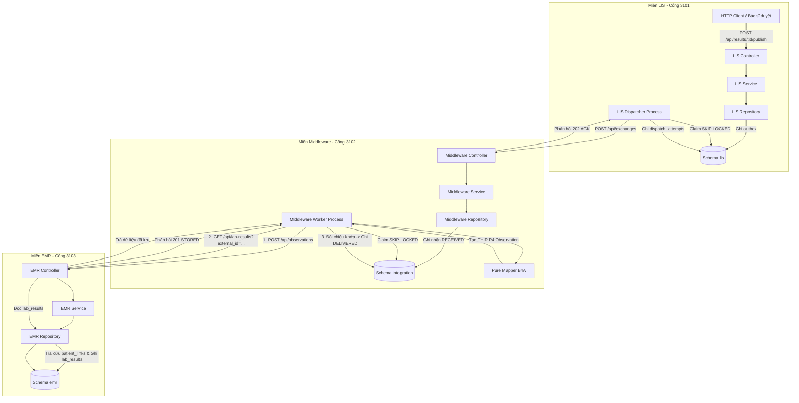
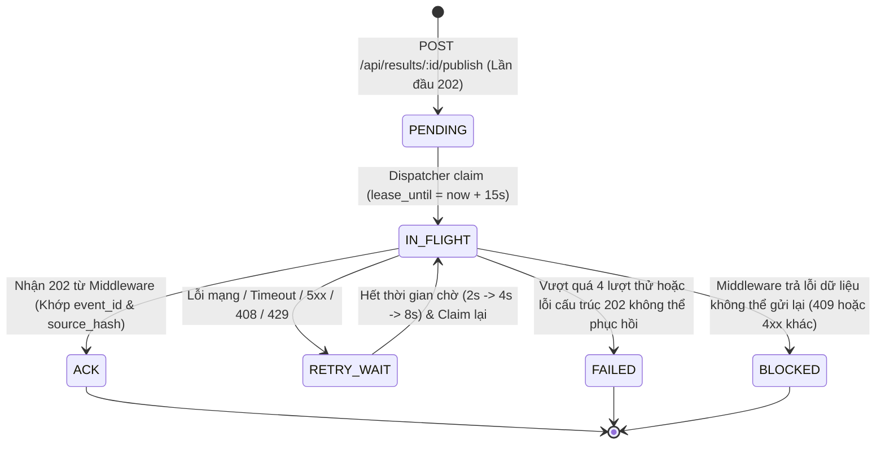
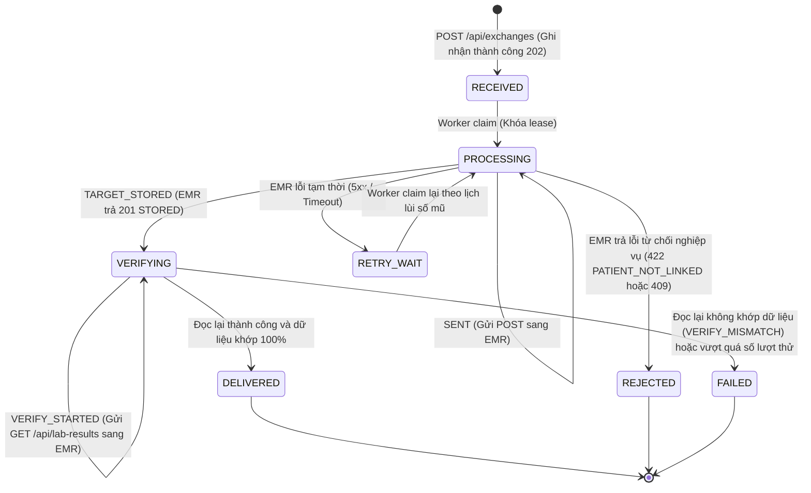

# SPP-66 D4 — Báo cáo Đánh giá Kỹ thuật và Kiểm toán Cuối cùng (Final Review Report)

**Dự án:** Trao đổi kết quả xét nghiệm LIS → Middleware → EMR (Chuẩn HL7 FHIR R4)  
**Mã nhiệm vụ (Task ID):** SPP-66 (Giai đoạn D4: Final Review and Handover)  
**Vai trò kiểm toán:** Senior Software Engineer, Technical Auditor & Documentation Reviewer  
**Ngày thực hiện kiểm toán:** 2026-10-30  
**Tình trạng working tree:** Sạch các lỗi biên dịch; bảo tồn toàn bộ mã nguồn nghiệp vụ từ A1 đến D3; cập nhật tài liệu cấu hình và hướng dẫn vận hành.  

---

## 1. Mục tiêu và phạm vi của SPP-66 (Objective and scope of SPP-66)

### 1.1. Mục tiêu cốt lõi
Mục tiêu của nhiệm vụ SPP-66 là thiết lập và kiểm chứng luồng tích hợp tự động, tin cậy để chuyển giao kết quả xét nghiệm cận lâm sàng từ hệ thống quản lý xét nghiệm (**LIS - Laboratory Information System**) qua tầng trung gian (**Middleware**) tới hệ thống bệnh án điện tử (**EMR - Electronic Medical Record**), áp dụng định dạng chuẩn **HL7 FHIR R4 Observation**.

### 1.2. Tiêu chuẩn hoàn thành theo thiết kế (Acceptance Scope)
- **Tách biệt dữ liệu và quyền truy cập:** Ba dịch vụ chạy độc lập, sở hữu 3 schema riêng biệt (`lis`, `integration`, `emr`) trên cơ sở dữ liệu PostgreSQL `dacn_db`, chỉ tương tác qua giao thức HTTP RESTful.
- **Tính bất biến và trách nhiệm gửi (Outbox Pattern):** LIS không gửi trực tiếp tại thời điểm người dùng duyệt kết quả; việc phát hành (Publish) phải ghi nhận vào bảng outbox `lis.publish_events` trước khi xử lý chuyển giao.
- **Đóng gói và bảo toàn định dạng FHIR R4:** Middleware tiếp nhận gói tin từ LIS, kiểm tra tính toàn vẹn (Canonical SHA-256), chuyển đổi thành tài nguyên FHIR R4 `Observation` thông qua hàm ánh xạ độc lập không phụ thuộc cơ sở dữ liệu.
- **Xác định danh tính bệnh nhân:** EMR ánh xạ định danh bệnh nhân nguồn (`subject.identifier`) sang định danh bệnh nhân nội bộ EMR (`emr.patient_links` $\rightarrow$ `patient_key`).
- **Xác minh hai chiều (Read-back Verification):** Middleware chỉ được phép kết luận trạng thái thành công cuối cùng (**`DELIVERED`**) sau khi đã gọi ngược lại HTTP `GET /api/lab-results` tại EMR và đối chiếu khớp 100% các trường dữ liệu số học, đơn vị, mốc thời gian và JSON gốc.
- **Khả năng phục hồi và Idempotency:** Hệ thống phải chống gửi trùng (at-most-once storage), xử lý được lỗi mạng, đứt kết nối, mất gói phản hồi ACK, ngắt tiến trình đột ngột (`SIGKILL`) và tranh chấp tài nguyên giữa nhiều tiến trình đồng thời.

### 1.3. Giới hạn phạm vi (Explicit Out-of-Scope)
- **Dữ liệu lâm sàng thật:** Toàn bộ quá trình kiểm thử sử dụng dữ liệu giả lập có chủ đích (hand-authored synthetic test data) và đáp án riêng biệt; **chưa** thực hiện kiểm thử nghiệm thu trên tập dữ liệu lâm sàng MIMIC hoặc tập chuẩn SPP-65.
- **Môi trường triển khai:** Kiểm thử thực hiện trên Docker cục bộ và PostgreSQL container cô lập; **chưa** triển khai môi trường phân tán nhiều máy chủ vật lý, chưa thiết lập chứng chỉ TLS/mTLS, chưa kiểm thử tải nặng (load/stress testing).
- **Giao diện người dùng (Frontend):** Ứng dụng frontend (SPP-67) là hạng mục độc lập kế tiếp, chưa nằm trong phạm vi nghiệm thu của SPP-66.

---

## 2. Kiến trúc hệ thống đã triển khai (Implemented system architecture)

Kiến trúc triển khai thực tế tuân thủ mô hình phân lớp nghiêm ngặt, cách ly trách nhiệm và không tồn tại kết nối chéo giữa các tầng:



### Các thành phần chính và phân bổ tệp mã nguồn:
- **Tầng LIS (`backend/src/lis/`):**
  - [controller.ts](file:///home/thien408/Projects/2026-2027/dacn/lis-fhir-emr/backend/src/lis/controller.ts): Tiếp nhận HTTP cho 4 API nghiệp vụ và tài liệu Swagger UI.
  - [service.ts](file:///home/thien408/Projects/2026-2027/dacn/lis-fhir-emr/backend/src/lis/service.ts): Thẩm định điều kiện kết quả (`FINAL`), tính toán Canonical SHA-256 hash.
  - [repository.ts](file:///home/thien408/Projects/2026-2027/dacn/lis-fhir-emr/backend/src/lis/repository.ts): Thao tác nguyên tử trên các bảng `lis.results`, `lis.publish_events`, `lis.dispatch_attempts`.
  - [dispatcher.ts](file:///home/thien408/Projects/2026-2027/dacn/lis-fhir-emr/backend/src/lis/dispatcher.ts) & [dispatcher-main.ts](file:///home/thien408/Projects/2026-2027/dacn/lis-fhir-emr/backend/src/lis/dispatcher-main.ts): Tiến trình nền quét hàng đợi outbox và gọi sang Middleware.
- **Tầng Middleware (`backend/src/middleware/`):**
  - [controller.ts](file:///home/thien408/Projects/2026-2027/dacn/lis-fhir-emr/backend/src/middleware/controller.ts): Tiếp nhận `POST /api/exchanges` và các endpoint tra cứu.
  - [service.ts](file:///home/thien408/Projects/2026-2027/dacn/lis-fhir-emr/backend/src/middleware/service.ts): Kiểm tra tính toàn vẹn gói tin, đối chiếu idempotency.
  - [repository.ts](file:///home/thien408/Projects/2026-2027/dacn/lis-fhir-emr/backend/src/middleware/repository.ts): Quản lý vòng đời giao dịch, phân bổ lease và lưu vết audit events.
  - [mapper.ts](file:///home/thien408/Projects/2026-2027/dacn/lis-fhir-emr/backend/src/middleware/mapper.ts): Chuyển đổi dữ liệu nguồn sang FHIR R4 Observation theo quy tắc MR01–MR09.
  - [worker.ts](file:///home/thien408/Projects/2026-2027/dacn/lis-fhir-emr/backend/src/middleware/worker.ts) & [worker-main.ts](file:///home/thien408/Projects/2026-2027/dacn/lis-fhir-emr/backend/src/middleware/worker-main.ts): Tiến trình nền gửi dữ liệu sang EMR và đọc lại đối soát.
  - [worker-verification.ts](file:///home/thien408/Projects/2026-2027/dacn/lis-fhir-emr/backend/src/middleware/worker-verification.ts): Thuật toán so khớp trường dữ liệu lossless độc lập.
- **Tầng EMR (`backend/src/emr/`):**
  - [controller.ts](file:///home/thien408/Projects/2026-2027/dacn/lis-fhir-emr/backend/src/emr/controller.ts): Tiếp nhận `POST /api/observations` (`application/fhir+json`) và `GET /api/lab-results`.
  - [service.ts](file:///home/thien408/Projects/2026-2027/dacn/lis-fhir-emr/backend/src/emr/service.ts): Thẩm tra định dạng FHIR R4, giải quyết danh tính bệnh nhân.
  - [repository.ts](file:///home/thien408/Projects/2026-2027/dacn/lis-fhir-emr/backend/src/emr/repository.ts): Thao tác đọc/ghi cơ sở dữ liệu với bảo toàn định dạng số thực NUMERIC và thời gian microsecond.

---

## 3. Trách nhiệm của LIS, Middleware và EMR (LIS, Middleware and EMR responsibilities)

| Tiêu chí | Hệ thống LIS | Hệ thống Middleware | Hệ thống EMR |
|---|---|---|---|
| **Vai trò chính** | Nguồn phát sinh dữ liệu xét nghiệm và quản lý duyệt kết quả | Cầu nối chuyển đổi định dạng, đảm bảo độ tin cậy và kiểm chứng | Điểm tiếp nhận lưu trữ hồ sơ bệnh án chuẩn hóa |
| **Quyền hạn Database** | Toàn quyền trên schema `lis` (`lis_app`). Bị cấm truy cập `integration` và `emr` | Toàn quyền trên schema `integration` (`integration_app`). Bị cấm truy cập `lis` và `emr` | Toàn quyền trên schema `emr` (`emr_app`). Bị cấm truy cập `lis` và `integration` |
| **Trách nhiệm bảo toàn** | Bảo toàn kết quả nguồn, tạo snapshot và tính Canonical SHA-256 không đổi | Đóng gói nguyên vẹn `source_payload`, chuyển đổi không làm tròn số học hay mất phần lẻ giây | Bảo toàn `fhir_json` gốc, lưu trữ chính xác các trường trích xuất dạng cột |
| **Trách nhiệm định danh** | Quản lý `result_id` và `patient_id` nội bộ LIS | Quản lý `event_id` (từ LIS) và `exchange_id` (nội bộ Middleware) | Ánh xạ `subject.identifier` sang `patient_key`, cấp phát `target_id` |
| **Trách nhiệm trạng thái** | Ghi nhận `ACK` khi Middleware trả 202 hợp lệ khớp mã băm | Ghi nhận `DELIVERED` khi EMR phản hồi 201 và kiểm chứng đọc lại GET 200 khớp hoàn toàn | Báo cáo `STORED` (lần đầu) hoặc `ALREADY_EXISTS` (khi gửi lại) |

---

## 4. Tình trạng triển khai hợp đồng API (API contract implementation status)

Đối chiếu chi tiết giữa tài liệu đặc tả [docs/api-contract.md](file:///home/thien408/Projects/2026-2027/dacn/lis-fhir-emr/docs/api-contract.md) và mã nguồn thực tế:

| Phương thức & Đường dẫn | Mục đích nghiệp vụ | Headers yêu cầu | Trạng thái mã nguồn | Bằng chứng kiểm thử |
|---|---|---|---|---|
| `GET /api/results` | Xem/lọc kết quả xét nghiệm tại LIS | N/A | Hoàn thành | `tests/lis/controller.integration.test.ts` |
| `GET /api/results/:resultId` | Chi tiết kết quả xét nghiệm | N/A | Hoàn thành | `tests/lis/controller.integration.test.ts` |
| `POST /api/results/:resultId/publish` | Lưu yêu cầu phát hành kết quả (Outbox) | `Content-Type: application/json` (tùy chọn) | Hoàn thành | `tests/lis/controller.integration.test.ts`, D3-01..D3-10 |
| `GET /api/publish-events/:eventId` | Tra cứu tiến độ gửi từ LIS | N/A | Hoàn thành | `tests/lis/controller.integration.test.ts` |
| `POST /api/exchanges` | Middleware nhận gói tin từ LIS | `Content-Type: application/json` | Hoàn thành | `tests/middleware/controller.integration.test.ts`, D3-01..D3-10 |
| `GET /api/exchanges` | Xem/lọc danh sách giao dịch trao đổi | N/A | Hoàn thành | `tests/middleware/controller.integration.test.ts` |
| `GET /api/exchanges/:exchangeId` | Tra cứu chi tiết giao dịch & lịch sử audit | N/A | Hoàn thành | `tests/middleware/controller.integration.test.ts` |
| `POST /api/observations` | EMR tiếp nhận tài nguyên FHIR R4 Observation | `Content-Type: application/fhir+json` | Hoàn thành | `tests/emr/controller.integration.test.ts`, C4-01..C4-08, D3-01..D3-10 |
| `GET /api/lab-results` | Đọc lại kết quả đã lưu theo cặp định danh hoặc bệnh nhân | N/A | Hoàn thành | `tests/emr/controller.integration.test.ts`, C4-01..C4-08, D3-01..D3-10 |
| `GET /health` | Kiểm tra trạng thái HTTP server (cả 3 service) | N/A | Hoàn thành | `smoke-test.mjs` |
| `GET /ready` | Kiểm tra kết nối và schema database (cả 3 service) | N/A | Hoàn thành | `db-check.mjs`, D3-ENV |

---

## 5. Luồng trạng thái của LIS Dispatcher và Worker (LIS Dispatcher and Worker state flows)

### 5.1. Luồng trạng thái tại LIS Outbox (`lis.publish_events.dispatch_status`)


### 5.2. Luồng trạng thái tại Middleware Transaction (`integration.exchange_transactions.status`)


---

## 6. Môi trường kiểm thử và bằng chứng D3 (D3 test environment and evidence)

### 6.1. Xác minh tệp bằng chứng lịch sử (Historical Test Evidence)
- Tệp bằng chứng JSON: [docs/evidence/spp-66-d3.json](file:///home/thien408/Projects/2026-2027/dacn/lis-fhir-emr/docs/evidence/spp-66-d3.json)
- Tệp log kiểm thử tổng thể: [docs/evidence/spp-66-d3-test-output.txt](file:///home/thien408/Projects/2026-2027/dacn/lis-fhir-emr/docs/evidence/spp-66-d3-test-output.txt)
- Tệp log cơ chế bảo vệ cấu hình (guard): [docs/evidence/spp-66-d3-guard-output.txt](file:///home/thien408/Projects/2026-2027/dacn/lis-fhir-emr/docs/evidence/spp-66-d3-guard-output.txt)

### 6.2. Đối chiếu mã băm toàn vẹn (Integrity Checksums)
Đã thực hiện băm SHA-256 các tệp nguồn trong working tree tại thời điểm kiểm toán D4 và đối chiếu với trường metadata trong `docs/evidence/spp-66-d3.json`:

| Tệp kiểm tra | Mã SHA-256 trong bằng chứng D3 | Mã SHA-256 thực tế hiện tại | Kết luận đối chiếu |
|---|---|---|---|
| `database/dacn_db_init_v2.sql` | `42d313db34bd54ccedd3b3a60fef734b4f773ced5a0e3ba9b2b0c2414fd87439` | `42d313db34bd54ccedd3b3a60fef734b4f773ced5a0e3ba9b2b0c2414fd87439` | **KHỚP TUYỆT ĐỐI** |
| `database/access_roles.sql` | `d83ab593c1b0fb99237e7c9122e083f1fdaecae3bb16398f4ecb12992f33c0cb` | `d83ab593c1b0fb99237e7c9122e083f1fdaecae3bb16398f4ecb12992f33c0cb` | **KHỚP TUYỆT ĐỐI** |
| `backend/tests/e2e/fixtures/d3-synthetic.json` | `724615239b0cd683b720a1e734b43158b7cb691762c9e36ecd5418facf71bc36` | `724615239b0cd683b720a1e734b43158b7cb691762c9e36ecd5418facf71bc36` | **KHỚP TUYỆT ĐỐI** |

---

## 7. Ma trận ca kiểm thử D3: PASS / FAIL / BLOCKED (Test case matrix)

Toàn bộ 10 kịch bản kiểm thử bắt buộc (với 13 ca chạy cụ thể trong `backend/tests/e2e/lis-emr.e2e.test.ts`) đều đạt kết quả **PASS**:

| Mã ca kiểm thử | Nội dung kiểm tra thực tế | LIS Trạng thái | MW Trạng thái | EMR Số bản ghi | Kết quả |
|---|---|---|---|:---:|:---:|
| **D3-01** | Luồng thành công hoàn chỉnh: LIS Publish $\rightarrow$ Dispatcher tiến trình thật $\rightarrow$ Middleware $\rightarrow$ Worker tiến trình thật $\rightarrow$ EMR $\rightarrow$ Read-back đối soát | `ACK` | `DELIVERED` | 1 | **PASS** |
| **D3-02** | Thao tác Publish lặp lại trước và sau khi hoàn tất giao dịch; đảm bảo giữ nguyên `event_id`, không tạo bản ghi trùng lặp tại EMR | `ACK` | `DELIVERED` | 1 | **PASS** |
| **D3-03** | Middleware đã tiếp nhận trước đó; Dispatcher gửi lại gói tin giống hệt; Middleware trả lại `exchange_id` ban đầu và LIS cập nhật chuẩn xác | `ACK` | `DELIVERED` | 1 | **PASS** |
| **D3-04** | Cố tình ngắt cổng Middleware thật; LIS chuyển `RETRY_WAIT`, không ghi nhận ACK ảo; sau khi bật lại cổng thì tự phục hồi và giao dịch thành công | `ACK` | `DELIVERED` | 1 | **PASS** |
| **D3-05** | Bỏ rơi gói phản hồi 202 của Middleware sau khi đã commit; LIS gửi lại nguyên vẹn byte dữ liệu; không làm xáo trộn giao dịch đã hoàn tất | `ACK` | `DELIVERED` | 1 | **PASS** |
| **D3-06** | Thiếu liên kết bệnh nhân trong EMR; EMR trả 422 `PATIENT_NOT_LINKED`; Middleware ghi nhận `REJECTED`, tuyệt đối không gán nhầm sang bệnh nhân mồi | `ACK` | `REJECTED` | 0 | **PASS** |
| **D3-07** | Hai tiến trình LIS Dispatcher thật chạy đua đồng thời; cơ chế `SKIP LOCKED` đảm bảo chỉ 1 bên nhận việc, 1 exchange và 1 kết quả duy nhất | `ACK` | `DELIVERED` | 1 | **PASS** |
| **D3-08** | Bắn tín hiệu `SIGKILL` dừng đột ngột Dispatcher khi đang giữ lease; chờ lease hết hạn tự nhiên; tiến trình mới khởi động tiếp quản thành công | `ACK` | `DELIVERED` | 1 | **PASS** |
| **D3-09 (both)** | Thẩm tra dữ liệu độc lập: Có đủ cả hai cận tham chiếu (`low` và `high`), kiểm tra bảo toàn số thực và microsecond | `ACK` | `DELIVERED` | 1 | **PASS** |
| **D3-09 (low)** | Thẩm tra dữ liệu độc lập: Chỉ có cận dưới (`low`), kiểm tra số nguyên lớn sát giới hạn an toàn `9007199254740991` | `ACK` | `DELIVERED` | 1 | **PASS** |
| **D3-09 (high)** | Thẩm tra dữ liệu độc lập: Chỉ có cận trên (`high`), kiểm tra số thập phân cực nhỏ `0.000000123456789` | `ACK` | `DELIVERED` | 1 | **PASS** |
| **D3-09 (none)** | Thẩm tra dữ liệu độc lập: Không có khoảng tham chiếu (`referenceRange` bị loại bỏ hoàn toàn trong FHIR JSON) | `ACK` | `DELIVERED` | 1 | **PASS** |
| **D3-10** | Giữ lại kết nối đọc lại GET; chứng minh Middleware giữ nguyên trạng thái `VERIFYING` và chỉ chuyển `DELIVERED` khi nhận dữ liệu phản hồi thật | `ACK` | `DELIVERED` | 1 | **PASS** |

---

## 8. So sánh đối chiếu Dữ liệu nguồn vs FHIR vs EMR (Source vs FHIR vs EMR comparison)

Hệ thống chứng minh sự bảo toàn dữ liệu không thất thoát qua 9 quy tắc ánh xạ chuẩn (MR01–MR09):

```text
LIS Nguồn (PostgreSQL NUMERIC / ISO UTC)
   │
   ├── [MR01] result_id: "D3-SYNTHETIC-R-..." ──────> FHIR identifier[0].value ──────> EMR external_id
   ├── [MR02] patient_id: "D3-SYNTHETIC-P-..." ────> FHIR subject.identifier.value ──> Tra cứu patient_links -> patient_key (UUID)
   ├── [MR03] test_code & test_name ──────────────> FHIR code.coding[0] ────────────> EMR analyte_code & analyte_display
   ├── [MR04] value_num: 0.30000000000000004 ──────> FHIR valueQuantity.value ────────> EMR quantity (NUMERIC chuỗi "0.30000000000000004")
   ├── [MR05] unit: "mg/dL" ──────────────────────> FHIR valueQuantity.unit ─────────> EMR unit_text ("mg/dL")
   ├── [MR06] reference_low/high: 0.1 / 0.9 ──────> FHIR referenceRange[0].low/high ──> EMR low / high (Chuỗi số hoặc null)
   ├── [MR07] effective_at: 15:00 (+07:00) ───────> FHIR effectiveDateTime (08:00Z) ──> EMR effective_at (UTC giữ đủ 6 chữ số microsecond)
   ├── [MR08] result_status: "FINAL" ─────────────> FHIR status: "final" ────────────> EMR clinical_status ("final")
   └── [MR09] fluid & category ───────────────────> FHIR code.text & category ───────> EMR analyte_context & fhir_json
```

**Bảo toàn giá trị biên:**
- Số dấu phẩy động JavaScript nguy hiểm (`0.30000000000000004`): Được chuyển giao chính xác, không bị biến thành `0.3`.
- Giới hạn `Number.MAX_SAFE_INTEGER` (`9007199254740991`): Không bị tràn số hay mất độ chính xác.
- Mốc thời gian: Giữ nguyên độ chính xác 6 chữ số thập phân của microsecond (`.123456Z`), chuyển đổi múi giờ đồng nhất về UTC.

---

## 9. Khả năng Idempotency, Retries và Phục hồi sự cố (Idempotency, retries and recovery)

1. **Idempotency cấp phát hành LIS:**
   - Khi gọi `POST /api/results/:resultId/publish` nhiều lần cho cùng một kết quả xét nghiệm, LIS chỉ tạo duy nhất 1 bản ghi trong `lis.publish_events`. Lần gọi đầu trả HTTP 202; các lần tiếp theo trả HTTP 200 kèm `event_id` ban đầu.
2. **Idempotency cấp tiếp nhận Middleware:**
   - Khi nhận gói tin lặp lại có cùng `event_id` và cùng `source_hash`, Middleware không tạo giao dịch mới, không đặt lại lịch sử audit, mà trả về HTTP 202 kèm chính xác `exchange_id` đã cấp ban đầu. Nếu trùng ID nhưng sai khác nội dung, Middleware trả HTTP 409 Conflict.
3. **Idempotency cấp lưu trữ EMR:**
   - Khi nhận Observation trùng lặp (`external_system` + `external_id`), EMR không ghi đè bản ghi, trả về HTTP 200 `ALREADY_EXISTS` và giữ nguyên `target_id` cũ.
4. **Cơ chế Khóa phân tán (Database Lease Recovery):**
   - LIS Dispatcher và Middleware Worker đều sử dụng cơ chế cấp quyền tạm thời (`lease_until`) dựa trên đồng hồ của PostgreSQL (`CURRENT_TIMESTAMP`).
   - Nếu tiến trình xử lý bị treo hoặc bị `SIGKILL`, sau khi `lease_until` hết hạn, tiến trình kế tiếp sẽ tự động thu hồi quyền (`lease reclamation`) và tiếp tục xử lý mà không làm mất lịch sử các lần thử trước đó.
5. **Chính sách thử lại (Retry Policy):**
   - Dispatcher: Tối đa 4 lượt (1 lần đầu + 3 lần thử lại theo lịch 2s, 4s, 8s).
   - Worker: Tối đa 3 lần thử lại cho mỗi giai đoạn SEND và VERIFY độc lập.

---

## 10. Hạn chế về Bảo mật và Môi trường (Security and environment limitations)

1. **Phân quyền cơ sở dữ liệu nghiêm ngặt:**
   - Hệ thống đã kiểm chứng 3 tài khoản ứng dụng: `lis_app`, `integration_app`, `emr_app`. Mỗi tài khoản chỉ được cấp quyền hạn trên đúng schema của mình. Kiểm thử D1/D3 đã xác nhận: nếu tài khoản LIS cố truy cập schema `integration` hoặc `emr`, PostgreSQL sẽ lập tức từ chối quyền truy cập (Permission Denied).
2. **Bảo mật thông tin lỗi:**
   - Tất cả các lỗi cơ sở dữ liệu nội bộ khi trả về qua HTTP đều được vệ sinh (sanitized) thành mã `503 DEPENDENCY_UNAVAILABLE` với thông điệp chung, tuyệt đối không để lộ chuỗi kết nối, tên bảng, cấu trúc câu lệnh SQL hay stack trace.
3. **Giới hạn môi trường hiện tại:**
   - Chưa tích hợp cơ chế xác thực người dùng (Authentication / Authorization) qua JWT hoặc API Key.
   - Chưa cấu hình mã hóa đường truyền TLS/HTTPS giữa các dịch vụ.
   - Các API hiện tại chỉ được cấu hình chạy trong mạng nội bộ hoặc Docker network, **tuyệt đối không được mở public ra Internet**.

---

## 11. Kiểm tra Tái lập và Hồi quy trong D4 (Regression and reproducibility)

Trong khuôn khổ đợt kiểm toán D4 ngày 2026-10-30, kiểm toán viên đã trực tiếp kích hoạt lại toàn bộ các công cụ kiểm tra tự động trên môi trường máy chủ. Kết quả thực thi thực tế như sau:

| Lệnh thực thi | Mục đích kiểm tra | Kết quả thực thi trong D4 | Ghi chú kiểm toán |
|---|---|:---:|---|
| `npm run check` | Kiểm tra cú pháp và tính tương thích kiểu TypeScript | **PASS** | Không có lỗi kiểu trong `src/` và `tests/` |
| `npm run build` | Biên dịch TypeScript sang JavaScript trong `dist/` | **PASS** | Thư mục `dist/` được tạo đầy đủ |
| `npm run verify:sql` | Kiểm tra tính nhất quán của schema SQL | **PASS** | Đủ 3 schema, 13 bảng, ràng buộc DELIVERED |
| `npm run test:e2e:postgres` | Chạy riêng bộ kiểm thử End-to-End D3 trên PostgreSQL cô lập | **PASS (15/15)** | Thời gian chạy: ~8.9 giây, 0 fail, 0 skip |
| `npm run test:repositories:postgres` | Chạy toàn bộ 5 bộ kiểm thử của toàn hệ thống | **PASS (495/495)** | LIS: 173, MW: 191, EMR: 100, C4: 16, D3: 15 |

> **Xác nhận tính tái lập:** Bất kỳ kỹ sư nào chỉ cần có môi trường Docker và Node.js đều có thể chạy lại lệnh `npm run test:repositories:postgres` để tái hiện kết quả 495 tests PASS mà không cần cấu hình thủ công bất kỳ tham số cơ sở dữ liệu nào.

---

## 12. Rủi ro còn tồn đọng và Điểm chặn (Remaining risks and blockers)

1. **Bộ dữ liệu nghiệm thu thực tế:**
   - Hệ thống hiện mới kiểm chứng trên tập dữ liệu tổng hợp (`d3-synthetic.json`). Cần có đợt nghiệm thu độc lập với bộ dữ liệu lâm sàng chính thức từ đề án SPP-65 / MIMIC.
2. **Bộ xác thực FHIR chuẩn quốc tế:**
   - Cấu trúc Observation hiện tại được kiểm tra dựa trên hợp đồng nội bộ và kiểm tra cấu trúc schema JSON; chưa kết nối với máy chủ HAPI FHIR Validator chuẩn ngoài để kiểm tra conformance toàn diện.
3. **Độ lệch đồng hồ phân tán (Clock Drift):**
   - Các bài test microsecond hiện chạy trên cùng một máy chủ Docker chia sẻ đồng hồ hệ điều hành. Khi triển khai trên cụm máy chủ vật lý phân tán, cần cấu hình NTP đồng bộ thời gian chặt chẽ để đảm bảo thứ tự các mốc thời gian audit.
4. **Tích hợp Frontend (SPP-67):**
   - Frontend hiện chưa kết nối với các endpoint LIS Publish và EMR Results mới triển khai.

---

## 13. Bảng kiểm Nghiệm thu Jira SPP-66 (Jira SPP-66 acceptance checklist)

Đánh giá đối chiếu 7 tiêu chí nghiệm thu của Jira SPP-66:

- [x] **Tiêu chí 1: LIS phát hành và ghi nhận trách nhiệm gửi (Outbox):** Đã kiểm chứng hoàn chỉnh qua API `POST /api/results/:id/publish`, bảng `lis.publish_events` và tiến trình `lis-dispatcher`.
- [x] **Tiêu chí 2: Middleware tiếp nhận và ánh xạ sang FHIR R4 Observation:** Đã kiểm chứng qua API `POST /api/exchanges`, lưu `integration.exchange_transactions` và Pure Mapper B4A.
- [x] **Tiêu chí 3: EMR lưu trữ kết quả gắn đúng bệnh nhân:** Đã kiểm chứng qua API `POST /api/observations`, tra cứu `emr.patient_links` và lưu `emr.lab_results`.
- [x] **Tiêu chí 4: EMR đọc lại và xác minh hai chiều (DELIVERED):** Đã kiểm chứng qua API `GET /api/lab-results`, hàm kiểm chứng `worker-verification.ts` và trạng thái `DELIVERED`.
- [x] **Tiêu chí 5: Có mã nguồn thực tế, API, payload và nhật ký kiểm thử:** Mã nguồn đầy đủ, không dùng mock trong E2E runner, có bằng chứng JSON và log chi tiết.
- [x] **Tiêu chí 6: Tài liệu bàn giao đầy đủ và rõ ràng:** Đã cập nhật `README.md`, `.env.example`, `compose.yaml` và phát hành tài liệu bàn giao `docs/spp-66-handover.md`.
- [ ] **Tiêu chí 7: Thành viên trong nhóm hoàn tất chéo kiểm tra (Human cross-check):** Đang chờ thành viên phụ trách frontend/nghiệm thu thực hiện rà soát theo tài liệu bàn giao.

---

## 14. Tình trạng chéo kiểm tra của con người (Human cross-check status)

- **Trạng thái:** **PENDING HUMAN CROSS-CHECK** (Đang chờ đồng nghiệp kiểm tra độc lập).
- Kỹ sư kiểm toán đã chuẩn bị đầy đủ kịch bản chạy thử nghiệm, curl mẫu, và danh mục kiểm tra thủ công trong tài liệu bàn giao [docs/spp-66-handover.md](file:///home/thien408/Projects/2026-2027/dacn/lis-fhir-emr/docs/spp-66-handover.md).
- Thành viên nhóm cần thực thi kịch bản happy-path, kiểm tra các bảng cơ sở dữ liệu và xác nhận tính đầy đủ trước khi đóng nhiệm vụ trên Jira.

---

## 15. Kết luận và Khuyến nghị cuối cùng (Final recommendation)

1. **Khuyến nghị trạng thái Jira:**
   - Chuyển trạng thái nhiệm vụ SPP-66 sang: **READY FOR REVIEW** (Sẵn sàng để nghiệm thu kỹ thuật).
   - **KHÔNG** chuyển thẳng sang trạng thái **DONE** khi chưa có sự xác nhận chéo (Human Cross-check) từ thành viên thứ hai của nhóm và giảng viên/người hướng dẫn.
2. **Khuyến nghị kỹ thuật tiếp theo:**
   - Giữ nguyên toàn bộ mã nguồn backend đã kiểm thử ổn định.
   - Thành viên tiếp nhận sử dụng tài liệu `docs/spp-66-handover.md` để triển khai giao diện người dùng frontend (SPP-67).
   - Chuẩn bị bộ dữ liệu mẫu SPP-65 để chạy kiểm chứng lâm sàng trong giai đoạn tiếp theo.
