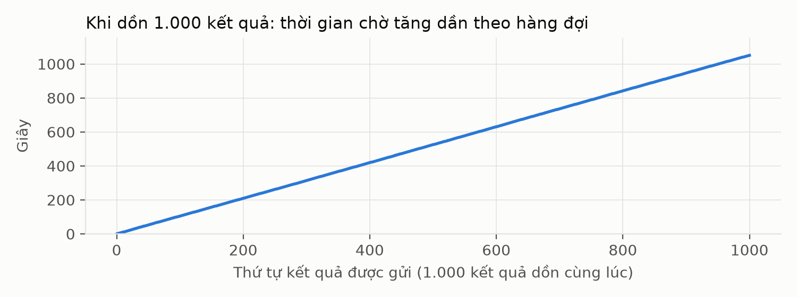
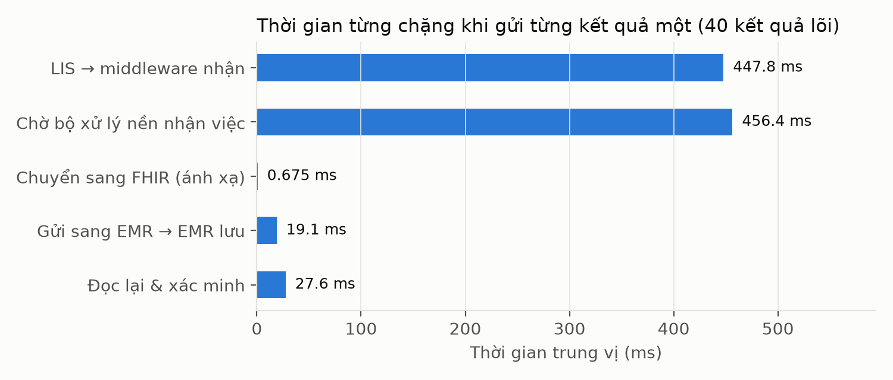
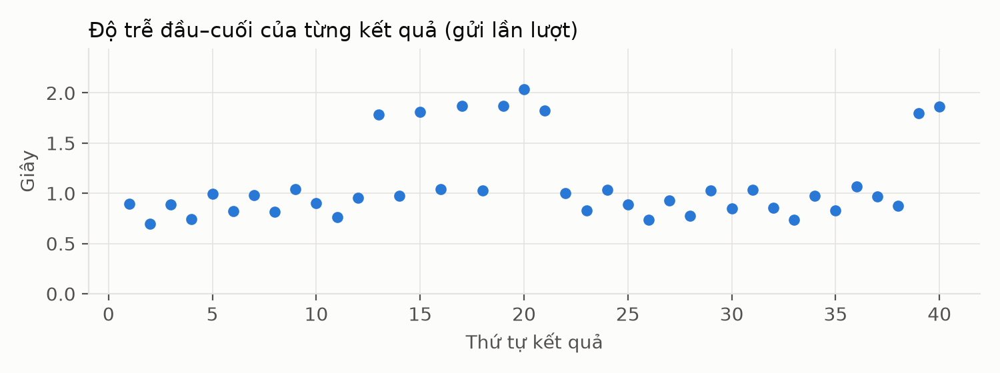
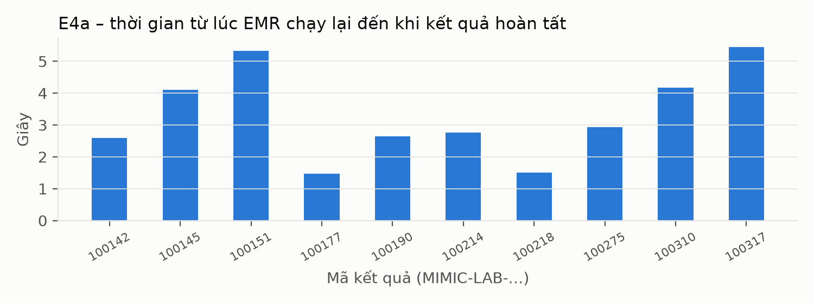

# Báo cáo kết quả thực nghiệm – Trao đổi kết quả xét nghiệm LIS → EMR qua FHIR R4

(đợt chạy 2026-11-11, commit `9924105`)

> Mọi con số trong báo cáo lấy từ `TONG_HOP_SO_LIEU.md`, `chi-so.json` hoặc các file minh chứng trong cùng thư mục.
> Các số tự tính thêm (nếu có) kèm lệnh ở phần Phụ lục. Phần "nhận định" luôn được tách riêng khỏi phần "đã đo".

## 0. Đọc nhanh

- **Luồng chính chạy đúng.** Cả 1000/1000 kết quả xét nghiệm đi trọn luồng LIS → middleware → EMR, đều ở trạng thái DELIVERED
  (đã lưu ở EMR và đã đọc lại đối chiếu đúng). Bộ đối chiếu độc lập kết luận PASS: 24000/24000 phép so sánh theo trường đều đúng.
- **Không sai bệnh nhân, không trùng, không báo hoàn tất sai:** M4 = 0, M5 = 0, M6 = 0 trên 1000 kết quả.
- **Gửi trùng được xử lý an toàn:** 15/15 phép kiểm tra đạt ở cả ba chặng (LIS, middleware, EMR). Số bản ghi vẫn là 1000 sau mọi lần gửi trùng.
- **Thành phần tạm ngừng:** EMR tắt ngắn và middleware tắt ngắn đều tự phục hồi 10/10 kết quả. Khi EMR tắt lâu (60 giây), 10/10 kết quả
  dừng ở FAILED, không kết quả nào lọt vào EMR; sau khi người vận hành đưa lại, 10/10 hoàn tất, mỗi kết quả đúng 1 bản ghi.
- **Độ trễ khi gửi từng kết quả:** trung vị 965,6 ms, p95 1,87 giây (40 kết quả lõi). Khi dồn 1000 kết quả cùng lúc, trung vị là 525,21 giây
  vì kết quả phải xếp hàng ở chặng LIS → middleware (xem mục 4.1).
- **Test tự động:** 514/514 test đạt; trong đó có 6 test liên quan TC06 và 23 test liên quan TC07, đều đạt.
- **Không như kỳ vọng (2 nhóm, 6 phép kiểm tra trên tổng số 67):**
  (1) mã xét nghiệm lạ lọt vào EMR (3 trong số 14 ca dữ liệu sai bị lưu, trong đó 2 ca bị báo DELIVERED) – hệ thống hiện chỉ kiểm tra "không rỗng",
  không đối chiếu với danh mục; (2) 0/1000 bản FHIR đạt kiểm tra của HL7 validator, vì cả 1000 bản đều có 3 lỗi do dùng địa chỉ `example.org`
  làm định danh hệ mã cục bộ. Đây là kết quả đo được, không phải lỗi thực nghiệm.

## 1. Thực nghiệm kiểm tra điều gì

| Kịch bản | Câu hỏi nó trả lời | Mã báo cáo giữa kỳ | Chỉ số |
|---|---|---|---|
| E1 | 1000 kết quả hợp lệ có đi trọn luồng, đúng bệnh nhân, đúng từng trường không? | TC01 | M1–M6, M9, M10 |
| E1A | Gửi từng kết quả một thì mất bao lâu, mỗi chặng chiếm bao nhiêu? | TC01 (thời gian) | M9, M10 |
| E2 | Bệnh nhân không liên kết và dữ liệu sai có bị chặn, không lưu vào EMR không? | TC02, TC03 | M4, M7 |
| E3 | Gửi trùng có làm sinh thêm bản ghi hoặc ghi đè không? | TC04 | M5, M7 |
| E4 | Khi EMR hoặc middleware tạm ngừng, hệ thống có tự phục hồi, không mất, không trùng không? | TC05 | M6, M7, M11, M12 |
| Test tự động | Hai tình huống khó tạo thật (mất phản hồi sau khi lưu; đọc lại thấy khác) có được xử lý đúng không? | TC06, TC07 | M7 |
| FHIR | Bản Observation xuất ra có đúng cấu trúc FHIR R4 không? | – | M8 |

*Đọc bảng này thế nào:* mỗi dòng là một kịch bản; cột "Chỉ số" chỉ ra chỉ số M nào được tính từ kịch bản đó.

## 2. Môi trường và dữ liệu

### 2.1 Máy và phần mềm

| Mục | Giá trị |
|---|---|
| Máy | Một máy tính, CPU 13th Gen Intel Core i5-13420H (12 luồng), RAM 15 GiB |
| Hệ điều hành | Linux 7.2.14-arch1-1 (x86_64) |
| Phần mềm | Node v26.13.0, Docker 29.9.3 / Compose 5.7.0, PostgreSQL 17, Java openjdk 27 (cho HL7 validator) |
| Chờ HTTP | 3 giây |
| Thử lại | sau 2, 4 và 8 giây (tối đa 4 lần) |
| Giữ việc (lease) | 15 giây |
| Quét hàng đợi | mỗi 1 giây; LIS và middleware mỗi bên 1 tiến trình xử lý nền |

*Đọc bảng này thế nào:* đây là cấu hình mặc định trong `compose.yaml` ở thời điểm chạy; code không có thay đổi chưa commit (0 file).

### 2.2 Dữ liệu

Bộ dữ liệu gồm 1000 kết quả từ MIMIC-IV Demo 2.2 (100 bệnh nhân, 5 loại xét nghiệm). Trong đó có 40 kết quả lõi (tập lõi đã mô tả ở chương 2).
Các ca thử lỗi (E2) là bản sao có mã `MUT-…` và được đánh dấu là dữ liệu tổng hợp (synthetic).

### 2.3 Cách bảo đảm khách quan

- Môi trường riêng (project Docker `lisexp`) được dựng lại sạch cho mỗi nhóm kịch bản.
- Bộ đáp án độc lập (spp65-v2) được lập riêng, không dùng code chuyển đổi của sản phẩm.
- Có ảnh chụp cơ sở dữ liệu trước và sau khi chạy E1.
- Mọi file minh chứng có mã SHA-256 (`MINH_CHUNG_SHA256.txt`, tạo ở bước 09).
- Không sửa code sản phẩm; một phép kiểm tra "không đạt" được giữ nguyên như một kết quả.

## 3. Cách tiến hành

**E1 (`02-E1-1000-ket-qua.sh`).** Mục đích: kiểm tra luồng chính với dữ liệu hợp lệ. Làm gì: chạy thử 20 kết quả, sau đó gửi 1000 kết quả (Publish: thao tác phát hành
kết quả ở LIS), chụp cơ sở dữ liệu trước/sau và đối chiếu từng trường với đáp án độc lập. Kỳ vọng: 1000/1000 đúng, M4 = M5 = M6 = 0.

**E1A (`05-E1A-do-tre-tung-ket-qua.sh`).** Mục đích: đo độ trễ thật. Làm gì: dựng môi trường mới, gửi lần lượt 40 kết quả lõi, mỗi lần chờ xong mới gửi tiếp.
Kỳ vọng: cả 40 xong ngay lần gửi đầu; thời gian không bị xếp hàng làm méo.

**E2 (`04-E2-sai-benh-nhan-du-lieu-sai.sh`).** Mục đích: kiểm tra hệ thống chặn dữ liệu sai. Làm gì: tạo 3 bệnh nhân không liên kết (TC02) và 14 ca dữ liệu sai (TC03:
6 ca gửi vào middleware, 8 ca gửi thẳng vào EMR). Kỳ vọng: mọi ca bị từ chối, EMR không lưu, không ca nào báo DELIVERED.

**E3 (`03-E3-gui-trung.sh`).** Mục đích: kiểm tra tính idempotent (gửi lại không gây thêm bản ghi). Làm gì: gửi lại y nguyên và gửi lại cùng mã nhưng khác nội dung ở LIS,
middleware và EMR. Kỳ vọng: gửi y nguyên thì trả lại mã cũ; khác nội dung thì bị từ chối hoặc báo xung đột; số bản ghi không đổi.

**E4 (`06-E4-gian-doan.sh`).** Mục đích: kiểm tra phục hồi khi thành phần tạm ngừng. Làm gì: (a) tắt EMR 5 giây; (b) tắt EMR 60 giây; (c) đưa các ca FAILED chạy lại bằng tay;
(d) tắt middleware 5 giây — mỗi lần gửi 10 kết quả. Kỳ vọng: ngừng ngắn thì tự phục hồi; ngừng lâu thì dừng ở FAILED và không báo hoàn tất sai.

**Test tự động (`01-test-tu-dong.sh`).** Chạy toàn bộ bộ test của repo trên một PostgreSQL tạm. TC06 và TC07 được chứng minh bằng các test này vì khó tạo lỗi thật bằng tay.

**FHIR (`07-kiem-tra-fhir.sh`).** Kiểm tra 1000 bản Observation đã xuất ở bước E1 bằng HL7 validator (công cụ kiểm tra chính thức của HL7), FHIR R4 (4.0.1).

## 4. Kết quả từng kịch bản

### 4.1 E1 – 1000 kết quả hợp lệ

| Chỉ số | Kết quả |
|---|---|
| Hoàn tất đầu–cuối (M1) | 1000/1000 kết quả; 40/40 kết quả lõi |
| Đúng theo trường (M2) | 24000/24000 phép so sánh; 960/960 với 40 kết quả lõi |
| Đầy đủ trường bắt buộc (M3) | 18302/18302 |
| Sai bệnh nhân (M4) / Lưu trùng (M5) / Báo hoàn tất nhưng sai (M6) | 0 / 0 / 0 trên 1000 kết quả |
| Chạy thử trước đó | 20/20 kết quả đi trọn luồng |

*Đọc bảng này thế nào:* M1 là tỷ lệ kết quả đi trọn luồng; M2 là tỷ lệ trường dữ liệu khớp đáp án độc lập (1000 kết quả × 24 phép so sánh mỗi kết quả). Chi tiết từng trường nằm ở mục 4 của `TONG_HOP_SO_LIEU.md`; cả 24 quy tắc/trường đều 1000 đúng, 0 sai, 0 chưa xác minh.

**Thời gian khi dồn 1000 kết quả cùng lúc.** Tổng thời gian từ Publish đến hoàn tất có trung vị 525,21 giây, p95 998,95 giây (p95: 95% kết quả nhanh hơn mức này),
lớn nhất 1050,71 giây; tốc độ xử lý khoảng 0,94 kết quả/giây. Bảng thời gian từng chặng:

| Chặng | Trung vị | p95 | Lớn nhất |
|---|---|---|---|
| LIS → middleware nhận | 524,23 giây | 998,44 giây | 1050,55 giây |
| Chờ bộ xử lý nền nhận việc | 463,6 ms | 946,2 ms | 1,02 giây |
| Ánh xạ sang FHIR | 0,723 ms | 1,3 ms | 2,3 ms |
| Gửi sang EMR → EMR lưu | 18,6 ms | 39,5 ms | 153,2 ms |
| Đọc lại và xác minh | 29,2 ms | 47,6 ms | 153,1 ms |

*Đọc bảng này thế nào:* chỉ chặng "LIS → middleware nhận" tăng lên hàng trăm giây; bốn chặng còn lại đều dưới 2 giây ở mọi kết quả (nhỏ hơn rất nhiều).

**Nhận định (suy luận từ số đo và code, không phải số đo trực tiếp).** Thời gian tăng dần theo thứ tự gửi: kết quả đầu tiên mất 0,3 giây ở chặng này, kết quả thứ 250 mất khoảng 261 giây,
thứ 500 khoảng 524 giây, thứ 750 khoảng 788 giây, thứ 1000 khoảng 1051 giây (lệnh ở Phụ lục). Tức khoảng 1,05 giây cho mỗi kết quả. Trong code đã thấy: tiến trình gửi nền của LIS
luôn nghỉ `pollMs` = 1000 ms giữa các vòng (`backend/src/lis/dispatcher.ts:134-140`), và truy vấn lấy việc có `limit(1)` (`backend/src/lis/repository.ts:326`).
Suy luận: mỗi vòng chỉ gửi 1 kết quả nên tốc độ bị giới hạn khoảng 1 kết quả/giây; "thời gian dài" ở đây chủ yếu là xếp hàng, không phải xử lý chậm.
Báo cáo không thử đổi cấu hình để kiểm chứng suy luận này.



*Hình 3.1 – Khi dồn 1000 kết quả cùng lúc, tổng thời gian của từng kết quả tăng gần như đường thẳng theo thứ tự gửi (từ khoảng 1 giây lên khoảng 1051 giây).*
Đọc hình này thế nào: trục ngang là thứ tự gửi, trục dọc là tổng thời gian từ Publish đến hoàn tất; đường thẳng dốc đều nghĩa là mỗi kết quả phải chờ thêm một lượng gần như nhau so với kết quả trước.

Minh chứng: `E1-1000-ket-qua/doi-chieu/comparison-report.json`, `E1-1000-ket-qua/dung-sai-theo-truong.csv`, `E1-1000-ket-qua/thoi-gian-tung-chang.csv`,
`E1-1000-ket-qua/ket-thuc.txt`, `kiem-tra.jsonl` (mã `E1-*`).

### 4.2 E1A – độ trễ khi gửi từng kết quả

| Chặng | Trung vị | p95 | Lớn nhất |
|---|---|---|---|
| LIS → middleware nhận | 447,8 ms | 961,4 ms | 1,02 giây |
| Chờ bộ xử lý nền nhận việc | 456,4 ms | 922,2 ms | 996,2 ms |
| Ánh xạ sang FHIR | 0,675 ms | 0,985 ms | 1,1 ms |
| Gửi sang EMR → EMR lưu | 19,1 ms | 31,7 ms | 56,4 ms |
| Đọc lại và xác minh | 27,6 ms | 41,9 ms | 90,3 ms |
| Tổng (Publish → hoàn tất) | 965,6 ms | 1,87 giây | 2,04 giây |

*Đọc bảng này thế nào:* 40/40 kết quả hoàn tất ngay lần gửi đầu, không phải thử lại. Hai chặng xấp xỉ 0,5–1 giây là chặng chờ chu kỳ quét 1 giây;
phần xử lý thật (ánh xạ, lưu, đọc lại) cộng lại chưa đến 0,1 giây ở trung vị.

**Nhận định.** Khi không bị xếp hàng, độ trễ chủ yếu do chu kỳ quét 1 giây (suy luận, khớp với việc hai chặng chờ đều dao động trong khoảng 0–1 giây).


*Hình 3.2 – Thời gian trung vị của từng chặng khi gửi từng kết quả một (40 kết quả lõi).* Hai chặng chờ (khoảng 0,45 giây mỗi chặng) chiếm gần hết tổng thời gian; ba chặng xử lý thật chỉ tính bằng mili giây.



*Hình 3.3 – Độ trễ đầu–cuối của từng kết quả trong 40 kết quả gửi lần lượt.* Đã đo: 32/40 kết quả hoàn tất trong 1,07 giây trở xuống, 8/40 kết quả mất từ 1,78 giây đến 2,04 giây (lệnh ở Phụ lục).
Nhận định (suy luận, chưa kiểm chứng): hai nhóm cách nhau cỡ một chu kỳ quét 1 giây, có thể do một số kết quả lỡ nhịp quét và phải chờ thêm một vòng.

Minh chứng: `E1A-do-tre-tung-ket-qua/thoi-gian-tung-chang.csv`, `kiem-tra.jsonl` (mã `E1A-*`).

### 4.3 E2 – sai bệnh nhân, dữ liệu sai

| Nhóm | Kết quả theo kỳ vọng | Ca không như kỳ vọng |
|---|---|---|
| Bệnh nhân không liên kết (TC02) | 3/3 | – |
| Dữ liệu sai gửi vào middleware (TC03) | 4/6 | mã xét nghiệm lạ; đơn vị đo lạ |
| Dữ liệu sai gửi thẳng vào EMR (TC03) | 7/8 | mã xét nghiệm lạ |
| Tổng (M7, riêng E2) | 14/17 | |

*Đọc bảng này thế nào:* "theo kỳ vọng" là ca bị chặn và EMR không lưu bản ghi nào. Con số M7 tổng 43/46 trong `TONG_HOP_SO_LIEU.md` gộp cả E3, E4 và test tự động (xem mục 5).

Các ca bị chặn đúng: bệnh nhân không có liên kết (REJECTED); mã bệnh nhân không tồn tại (REJECTED, REMOTE_VALIDATION_ERROR); thiếu giá trị (HTTP 400);
cận dưới lớn hơn cận trên (HTTP 422, ở cả middleware và EMR); chưa FINAL (HTTP 422); ở EMR còn có thiếu bệnh nhân, bệnh nhân không liên kết,
giá trị không phải số, thiếu thời điểm, sai loại tài nguyên (đều HTTP 422).

Ba ca lọt vào EMR (file `ban-ghi-loi-lot-vao-EMR.txt`): `MUT-MW-ma-xn-ngoai-danh-muc` (mã 99999), `MUT-MW-don-vi-khong-duoc-duyet` (đơn vị `kg`)
và `MUT-EMR-ma-xn-ngoai-danh-muc` (mã 99999). Hai ca đầu bị middleware báo DELIVERED. Nguyên nhân xem mục 6.

Minh chứng: `E2-sai-benh-nhan-du-lieu-sai/7a-ket-qua.txt`, `7b-ket-qua.txt`, `7c-ket-qua.txt`, `ban-ghi-loi-lot-vao-EMR.txt`; gói tin và phản hồi từng ca nằm cùng thư mục.

### 4.4 E3 – gửi trùng

| Chặng | Gửi y nguyên | Gửi cùng mã, khác nội dung |
|---|---|---|
| LIS (3 kết quả) | LIS trả 200, giữ đúng mã sự kiện cũ (6/6 phép kiểm tra đạt) | – |
| Middleware | nhận (HTTP 202), trả đúng mã giao dịch cũ | bị từ chối (4xx) |
| EMR | HTTP 200, trả đúng mã bản ghi cũ | HTTP 409, giá trị cũ (0,3) không bị ghi đè |

*Đọc bảng này thế nào:* 15/15 phép kiểm tra đạt. Sau mọi lần gửi trùng, số sự kiện / giao dịch / bản ghi EMR vẫn là 1000/1000/1000 và không có mã nào bị lưu 2 lần.

Minh chứng: `E3-gui-trung/` (đặc biệt `dem-sau.txt`), `kiem-tra.jsonl` (mã `E3-*`).

### 4.5 E4 – thành phần tạm ngừng

| Tình huống (10 kết quả mỗi lần) | Kết quả |
|---|---|
| E4a – EMR tắt 5 giây | 10/10 tự hoàn tất; 6 kết quả phải gửi lại; 10/10 đúng 1 bản ghi; phục hồi: trung vị 2,76 giây, lớn nhất 5,45 giây |
| E4b – EMR tắt 60 giây | 0 ca báo hoàn tất khi EMR tắt; 10/10 dừng ở FAILED; 0 bản ghi lọt vào EMR; LIS vẫn ghi nhận ACK cho 10/10 |
| E4c – người vận hành đưa lại | 10/10 hoàn tất; 10/10 đúng 1 bản ghi |
| E4d – middleware tắt 5 giây | LIS không báo ACK giả (0); 10/10 tự gửi lại và hoàn tất; không sinh giao dịch trùng; phục hồi: trung vị 6,25 giây, lớn nhất 10,82 giây |

*Đọc bảng này thế nào:* 12/12 phép kiểm tra đạt. Với tắt ngắn, tự phục hồi 10/10. Với tắt lâu, hệ thống không tự phục hồi mà dừng ở FAILED (đúng thiết kế: hết số lần thử lại thì dừng);
cần người vận hành đưa lại.



*Hình 3.4 – E4a: thời gian từ lúc EMR chạy lại đến khi từng kết quả hoàn tất (10 kết quả).* Các cột cao nhất khoảng 5,3–5,4 giây, thấp nhất khoảng 1,5 giây; số liệu trung vị và lớn nhất (2,76 giây và 5,45 giây) lấy từ bảng trên.

Minh chứng: `E4-gian-doan/E4a-ket-qua.csv`, `E4b-ket-qua.csv`, `E4c-ket-qua.csv`, `E4d-ket-qua.csv`, `kiem-tra.jsonl` (mã `E4*`).

### 4.6 TC06, TC07 qua test tự động

Bộ test tự động chạy 514 test, 514 đạt, 0 không đạt, 0 bỏ qua. Số test làm minh chứng: TC06 (EMR đã lưu nhưng phản hồi bị mất, gửi lại không sinh bản ghi mới): 6 test đạt,
0 không đạt, ví dụ "POST timeout AFTER storage safely resends identical FHIR and gets ALREADY_EXISTS". TC07 (đọc lại thấy dữ liệu khác thì không báo hoàn tất): 23 test đạt, 0 không đạt,
ví dụ "read-back quantity mismatch is FAILED/VERIFY_MISMATCH, never delivered".

*Đọc mục này thế nào:* đây là bằng chứng từ test chạy trên cơ sở dữ liệu tạm, không phải lỗi thật được tạo trong luồng chạy thực nghiệm.

Minh chứng: `01-test-tu-dong/tom-tat.txt`, `01-test-tu-dong/test-minh-chung-TC06-TC07.txt`.

### 4.7 Cấu trúc FHIR

HL7 validator (FHIR R4 4.0.1) đọc được kết quả của 1000/1000 file. Số file không có lỗi: 0/1000. Mỗi file đều có đúng 3 lỗi cùng loại (tổng 3000 lượt lỗi):

| Vị trí | Nội dung lỗi (rút gọn) | Số file |
|---|---|---|
| `Observation.identifier[0].system` | Example URLs are not allowed (`https://example.org/lis/result`) | 1000 |
| `Observation.code.coding[0].system` | Example URLs are not allowed (`https://example.org/lis/test-code`) | 1000 |
| `Observation.subject.identifier.system` | Example URLs are not allowed (`https://example.org/lis/patient`) | 1000 |

*Đọc bảng này thế nào:* validator không báo lỗi cấu trúc nào khác ngoài 3 loại trên. Cả ba lỗi đều do tên miền `example.org` (tên miền dành riêng cho ví dụ) trong định danh.
Ngoài ra có các cảnh báo (warning) ở cả 1000 file: không tìm thấy định nghĩa CodeSystem cục bộ, thiếu phần mô tả văn bản (narrative), thiếu người thực hiện (performer),
và năm xét nghiệm nằm ngoài khoảng "hợp lý" (do MIMIC-IV dời ngày sang các năm 21xx để khử định danh).

Minh chứng: `kiem-tra-fhir/tom-tat.txt`, `kiem-tra-fhir/ket-qua-validator.json`, `kiem-tra-fhir/log-validator.txt`.

## 5. Tổng hợp chỉ số M1–M13

| Chỉ số | Ý nghĩa | Kết quả | Đạt kỳ vọng? | Ghi chú |
|---|---|---|---|---|
| M1 | Tỷ lệ hoàn tất đầu–cuối | 1000/1000; 40/40 lõi | Đạt (kỳ vọng 100%) | |
| M2 | Độ chính xác theo trường | 24000/24000; 960/960 lõi | Đạt (kỳ vọng 100%) | |
| M3 | Tính đầy đủ trường | 18302/18302; 730/730 lõi | Không đặt ngưỡng | chỉ mô tả |
| M4 | Gắn sai bệnh nhân | 0 (E1); E2: 3/3 ca không liên kết bị từ chối | Đạt (kỳ vọng 0) | |
| M5 | Bản ghi trùng ở EMR | 0 (E1); 0 sau E3 | Đạt (kỳ vọng 0) | |
| M6 | Báo hoàn tất nhưng sai | 0 (E1); 0 ở E4b | **Đạt ở E1, E4b**; xem ghi chú | Ở E2, 2 ca dữ liệu sai bị DELIVERED (mục 6) |
| M7 | Ca ngoại lệ xử lý đúng | Tổng 43/46; TC02 3/3; TC03 vào middleware 4/6; TC03 vào EMR 7/8; TC04 15/15; TC05 12/12; TC06 1/1; TC07 1/1 | Báo theo nhóm | TC03 chưa đạt toàn bộ |
| M8 | Bản FHIR đạt HL7 validator | 0/1000 | **Không đạt** | 3 lỗi `example.org` mỗi file (mục 4.7) |
| M9 | Độ trễ đầu–cuối | Từng kết quả: trung vị 965,6 ms, p95 1,87 giây; dồn 1000: trung vị 525,21 giây, p95 998,95 giây | Không đặt ngưỡng | chỉ mô tả |
| M10 | Thời gian ánh xạ | Từng kết quả: trung vị 0,675 ms; dồn 1000: trung vị 0,723 ms | Không đặt ngưỡng | chỉ mô tả |
| M11 | Thời gian phục hồi | EMR tắt ngắn: trung vị 2,76 giây (n=10); middleware tắt ngắn: 6,25 giây (n=10) | Không đặt ngưỡng | chỉ mô tả |
| M12 | Tỷ lệ phục hồi | E4a 10/10; E4d 10/10; E4b tự phục hồi 0 (đúng thiết kế); E4c 10/10 | Không đặt ngưỡng | chỉ mô tả |
| M13 | Bao phủ bằng chứng yêu cầu cốt lõi | 10/12 (83,3%) | Không đặt ngưỡng | 2 yêu cầu có ca không đạt: REQ-FHIR-01, REQ-ERR-01 |

*Đọc bảng này thế nào:* "Đạt kỳ vọng" chỉ áp cho M1, M2, M4, M5, M6 (kế hoạch đặt kỳ vọng 100%, 100%, 0, 0, 0). Các chỉ số còn lại chương 2 không đặt ngưỡng nên chỉ mô tả.
Các p95 ở M9 tính theo cách "nearest-rank" (lấy phần tử theo thứ hạng), giống công cụ đo của repo.

## 6. Những điểm không như kỳ vọng và nguyên nhân

**6.1 Mã xét nghiệm lạ lọt vào EMR (TC03-MW-1, TC03-EMR-7).**
- *Hiện tượng:* gói tin có `test_code` = 99999 (không có trong danh mục 5 loại xét nghiệm) được middleware nhận và báo DELIVERED; EMR lưu 1 bản ghi. Gửi thẳng vào EMR cũng được lưu (HTTP 201).
- *Nguyên nhân (đã thấy trong code):* middleware chỉ kiểm tra `test_code` không rỗng (`backend/src/middleware/service.ts:135-138`); ánh xạ chỉ kiểm tra định dạng khoảng trắng (`mapper.ts:101`).
  Tìm trong `backend/src/middleware` và `backend/src/emr` không thấy bảng danh mục mã hay danh sách đơn vị được chấp nhận. *Suy luận:* hệ thống chưa có bước đối chiếu danh mục.
- *Ảnh hưởng:* một kết quả có mã lạ sẽ được lưu và báo hoàn tất như kết quả hợp lệ.
- *Đề xuất (chưa thực hiện):* thêm bước đối chiếu mã xét nghiệm với danh mục ở middleware và/hoặc EMR, trả lỗi 422 khi không có trong danh mục.

**6.2 Đơn vị đo lạ lọt qua middleware (TC03-MW-2).**
- *Hiện tượng:* gói tin có đơn vị `kg` cho xét nghiệm creatinine được middleware báo DELIVERED; EMR lưu bản ghi với `unit_text` = `kg`.
- *Nguyên nhân:* cùng nguyên nhân 6.1 — chỉ kiểm tra `unit` không rỗng (`service.ts:135-138`).
- *Lưu ý để tránh hiểu sai (TC03-EMR-8 đạt):* khi gửi thẳng vào EMR, ca đơn vị `kg` bị từ chối (HTTP 422, "Reference units must exactly match valueQuantity.unit"). Quan sát từ file gói tin: ca này chỉ đổi đơn vị ở `valueQuantity`
  còn đơn vị của cận tham chiếu vẫn là `mg/dL`, nên EMR từ chối vì hai đơn vị không khớp nhau (`backend/src/emr/service.ts:153`), chứ không phải vì `kg` không nằm trong danh sách. Vì vậy phép kiểm tra TC03-EMR-8 "đạt" nhưng không chứng minh EMR có danh sách đơn vị.
- *Ảnh hưởng:* đơn vị sai nhưng nhất quán giữa giá trị và cận tham chiếu vẫn được lưu.
- *Đề xuất (chưa thực hiện):* như 6.1, đối chiếu đơn vị với danh sách đơn vị chấp nhận theo từng xét nghiệm.

**6.3 Hai phép kiểm tra tổng của E2 (E2-TONG-1, E2-TONG-2).**
- *Hiện tượng:* 2 ca dữ liệu sai bị báo DELIVERED (kỳ vọng 0) và 3 ca có bản ghi lọt vào EMR (kỳ vọng 0).
- *Nguyên nhân:* là tổng hợp của ba ca ở 6.1 và 6.2 (2 ca qua middleware + 1 ca gửi thẳng vào EMR), không phải lỗi riêng.
- *Ảnh hưởng:* cùng mục 6.1–6.2.

**6.4 0/1000 bản FHIR đạt HL7 validator (FHIR-M8).**
- *Hiện tượng:* mỗi file có 3 lỗi `Example URLs are not allowed` ở ba định danh `identifier.system`, `code.coding.system`, `subject.identifier.system`.
- *Nguyên nhân (đã thấy trong code):* hệ mã cục bộ dùng địa chỉ `https://example.org/lis/...` (ví dụ `backend/src/middleware/mapper.ts:132`). Validator không cho dùng địa chỉ `example.org` trong các vị trí này.
  Validator không báo lỗi cấu trúc loại nào khác.
- *Ảnh hưởng:* theo tiêu chí "0 lỗi" của kế hoạch thì M8 không đạt. *Nhận định:* các lỗi này tập trung ở địa chỉ định danh; chưa thấy lỗi về cấu trúc dữ liệu (kiểu, trường bắt buộc). Báo cáo không khẳng định ngoài những gì validator đã báo.
- *Đề xuất (chưa thực hiện):* thay `example.org` bằng địa chỉ (URI) thật của dự án; về lâu dài dùng LOINC/UCUM; chạy lại validator để kiểm chứng.

## 7. Giới hạn của thực nghiệm

- Chỉ chạy trên một máy tính, một lần chạy; cấu hình mặc định như mục 2.1.
- Dữ liệu MIMIC-IV Demo đã khử định danh; ngày xét nghiệm đã bị dời sang các năm 21xx.
- Trạng thái FINAL và múi giờ UTC là giả định mô phỏng.
- Mã xét nghiệm là mã cục bộ, chưa dùng LOINC/UCUM.
- Thời gian phụ thuộc chu kỳ quét hàng đợi 1 giây; khi dồn 1000 kết quả, thời gian chủ yếu là xếp hàng, không phản ánh tốc độ xử lý từng kết quả (xem mục 4.1).
- TC06 và TC07 được chứng minh bằng test tự động chứ không tạo lỗi thật.
- Chưa đánh giá bảo mật, tải lớn, vận hành dài ngày.
- Biểu đồ (4 hình trong `bieu-do/`) được sinh ở lần chạy lại bước 08 sau khi cài `matplotlib`; biểu đồ chỉ vẽ lại các số trong file CSV, không thêm số mới.
- Hai script phải sửa vì lỗi vận hành (đếm kết quả của test và của validator, chi tiết ở Phụ lục); logic đo và tiêu chí đạt/không đạt không đổi.
- Tên một số hạng mục trong báo cáo giữa kỳ (TC01–TC07) được ánh xạ theo kịch bản như mục 1; M7 tổng 43/46 gộp các nhóm khác nhau nên khi trích nên nêu theo nhóm.

## 8. Gợi ý đưa vào Chương 3

| Đặt ở mục | Nội dung gợi ý | Câu chú thích mẫu |
|---|---|---|
| 3.x Môi trường | Bảng mục 2.1 | "Bảng 3.1 – Cấu hình máy và tham số hệ thống khi thực nghiệm" |
| 3.x Kết quả luồng chính | Bảng mục 4.1 (M1–M5) | "Bảng 3.2 – Kết quả 1000 kết quả xét nghiệm hợp lệ (E1)" |
| 3.x Độ trễ | Bảng thời gian từng chặng mục 4.2 và Hình 3.2, 3.3 | "Bảng 3.3 – Độ trễ khi gửi từng kết quả (40 kết quả lõi)" |
| 3.x Xếp hàng khi dồn tải | Hình 3.1 (mục 4.1) và số liệu kết quả thứ 1/250/500/750/1000 | "Hình 3.1 – Thời gian chờ tăng theo thứ tự gửi khi dồn 1000 kết quả (suy luận: do 1 kết quả/vòng quét 1 giây)" |
| 3.x Dữ liệu sai | Bảng mục 4.3 | "Bảng 3.4 – Xử lý dữ liệu sai và bệnh nhân không liên kết (E2)" |
| 3.x Gửi trùng | Bảng mục 4.4 | "Bảng 3.5 – Kết quả gửi trùng ở ba chặng (E3)" |
| 3.x Gián đoạn | Bảng mục 4.5 và Hình 3.4 | "Bảng 3.6 – Phục hồi khi EMR hoặc middleware tạm ngừng (E4)" |
| 3.x Cấu trúc FHIR | Bảng mục 4.7 | "Bảng 3.7 – Lỗi do HL7 validator báo trên 1000 bản Observation" |
| 3.x Tổng hợp | Bảng mục 5 | "Bảng 3.8 – Tổng hợp chỉ số M1–M13" |

Lưu ý: Phụ lục 1.3 chương 2 ghi lease 10 giây, nhưng giá trị thực khi chạy là 15 giây; cần thống nhất khi viết.
Nên nêu thẳng ở chương 3 các ca không như kỳ vọng (mục 6) như một kết quả đo được, kèm hướng cải thiện, thay vì bỏ qua.

## 9. Danh mục minh chứng

| Đường dẫn file (trong `thuc-nghiem/ket-qua/2026-11-11/`) | Chứa gì | Dùng cho mục |
|---|---|---|
| `TONG_HOP_SO_LIEU.md`, `chi-so.json` | Bảng số liệu tự sinh, chỉ số M1–M13 | 0, 4, 5 |
| `kiem-tra.jsonl` | Mỗi phép kiểm tra "kỳ vọng ↔ thực tế" | 4, 5, 6 |
| `nhat-ky-chay.log`, `trang-thai/` | Nhật ký và trạng thái từng bước | Phụ lục |
| `00-moi-truong.txt` | Cấu hình máy | 2.1 |
| `E1-1000-ket-qua/` (đối chiếu, thời gian từng chặng, ảnh chụp DB) | Minh chứng E1 | 4.1 |
| `E1A-do-tre-tung-ket-qua/` | Độ trễ từng kết quả | 4.2 |
| `E2-sai-benh-nhan-du-lieu-sai/` | Gói tin, phản hồi, bản ghi lọt vào EMR | 4.3, 6 |
| `E3-gui-trung/` | Minh chứng gửi trùng | 4.4 |
| `E4-gian-doan/` | Minh chứng tạm ngừng | 4.5 |
| `bieu-do/*.png` | 4 biểu đồ (Hình 3.1–3.4) | 4.1, 4.2, 4.5 |
| `01-test-tu-dong/` | Tóm tắt test, test minh chứng TC06/TC07 | 4.6 |
| `fhir-1000/`, `kiem-tra-fhir/` | 1000 bản FHIR và kết quả validator | 4.7, 6.4 |
| `MINH_CHUNG_SHA256.txt` | Dấu vân tay các file trên | 9 |

Kiểm tra lại: `cd thuc-nghiem/ket-qua/2026-11-11 && sha256sum -c MINH_CHUNG_SHA256.txt`

Lưu ý: ở bước 09, các file thô lớn hơn 5 MB được nén gzip để commit được (`kiem-tra-fhir/ket-qua-validator.json.gz`, `E1-1000-ket-qua/doi-chieu/field-comparisons.jsonl.gz`, `E1-1000-ket-qua/do-luong/per-result.jsonl.gz`). Giải nén bằng `gunzip <file>.gz`; nội dung giữ nguyên. Các đường dẫn `.json`/`.jsonl` tương ứng ở các mục trên nay có đuôi `.gz`.

## Phụ lục – Các lệnh đã chạy và các lần sửa script

**Thứ tự chạy:** `00-kiem-tra-truoc.sh` (đã có sẵn kết quả `.xong` từ trước) → `02` → `03` → `04` → `05` → `06` → `01` và `07` → `08` → viết báo cáo → `09`.
Chi tiết giờ chạy ở `TIEN_DO.md`.

**Sửa script (chỉ lỗi vận hành, không đổi tiêu chí):**
1. `07-kiem-tra-fhir.sh`: bản validator hiện tại không in dòng `Success/FAILURE` cho từng file nên phép đếm bằng `grep` ra 0 và làm script dừng. Đổi sang đếm từ `ket-qua-validator.json`
   (một file có lỗi nếu có issue mức `error` hoặc `fatal`) và liệt kê loại lỗi/cảnh báo từ JSON.
2. `01-test-tu-dong.sh`: Node dùng định dạng `spec` (`ℹ tests N`, `✔`/`✖`) thay vì TAP (`# tests N`, `ok`/`not ok`) nên không đếm được. Sửa hai dòng đếm/lọc để nhận cả hai dạng.
3. Lần chạy đầu của 01 và 07 khởi động cùng lúc nên tranh nhau file tạm của `kiem-tra.jsonl`; đã chạy lại tuần tự (không sửa script cho lỗi này).

**Lệnh tính số bổ sung (mục 4.1, nhận định về hàng đợi):** (chạy từ thư mục gốc repo)

```
python3 -I - <<'EOF'
import csv
r = list(csv.DictReader(open('thuc-nghiem/ket-qua/2026-11-11/E1-1000-ket-qua/thoi-gian-tung-chang.csv')))
s = sorted(r, key=lambda x: x['luc_publish'])
for i in (0, 249, 499, 749, 999):
    print(i + 1, round(float(s[i]['lis_sang_mw_ms']) / 1000, 1))
EOF
```

Kết quả: 0,3 / 261,0 / 524,2 / 788,1 / 1050,6 giây cho kết quả thứ 1 / 250 / 500 / 750 / 1000 (theo thứ tự Publish).

**Lệnh tìm trong code (mục 6):**
`grep -rn "test_code" backend/src/middleware backend/src/emr`, `grep -n "limit(1)" backend/src/lis/repository.ts`, `sed -n 130,140p backend/src/middleware/service.ts`.

**Đếm kết quả nhanh/chậm ở Hình 3.3 (mục 4.2):**

```
python3 -I - <<'EOF'
import csv
r = list(csv.DictReader(open('thuc-nghiem/ket-qua/2026-11-11/E1A-do-tre-tung-ket-qua/thoi-gian-tung-chang.csv')))
t = [float(x['tong_ms']) for x in r]
print(len(t), sum(v > 1500 for v in t), sum(v <= 1500 for v in t))
EOF
```

Kết quả: 40 kết quả; 8 kết quả trên 1500 ms (từ 1782 ms trở lên); 32 kết quả từ 1066 ms trở xuống.

**Đếm phép kiểm tra:** `grep -c '"ket_qua":"DAT"' kiem-tra.jsonl` = 61; `grep -c '"ket_qua":"KHONG_DAT"' kiem-tra.jsonl` = 6 (tổng 67).
