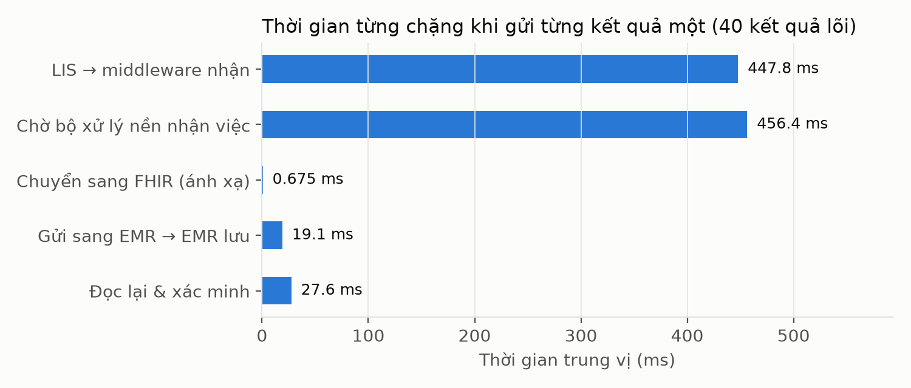
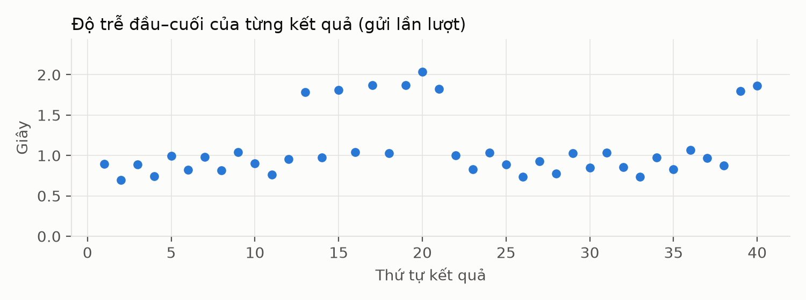
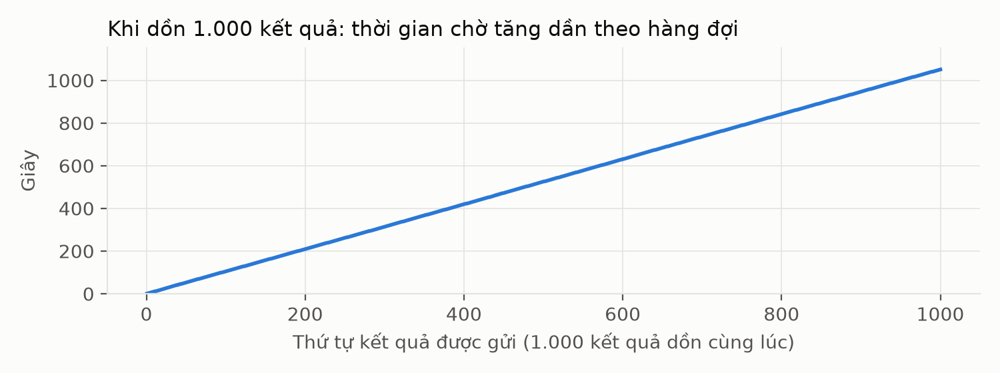
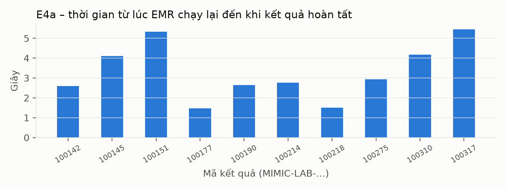

# Tổng hợp số liệu thực nghiệm – đợt 2026-11-11

> File này do `08-tong-hop.py` tự sinh từ dữ liệu thô. **Không sửa tay** – muốn sửa thì sửa dữ liệu/script rồi chạy lại.

## 0. Môi trường chạy

```
Thời điểm ghi: 2026-11-11T23:46:57.812+07:00
Commit đang chạy: 9924105ca4de54b33663e91bfb03bca0e388d7b5 (nhánh main)
Code có sửa chưa commit?: 0 file
Hệ điều hành: Linux 7.2.14-arch1-1 x86_64
CPU: 13th Gen Intel(R) Core(TM) i5-13420H, 12 luồng
RAM: 15Gi
Node: v26.13.0 | npm: 12.2.2
Docker: Docker version 29.9.3, build 5457199aa5 | Docker Compose version 5.7.0
PostgreSQL (image): postgres:17
Java: openjdk version "27.0.1.0.3" 2026-10-24
Cấu hình hệ thống khi đo (mặc định trong compose.yaml): chờ HTTP 3 s; thử lại sau 2 s, 4 s, 8 s (tối đa 4 lần);
  giữ việc (lease) 15 s; quét hàng đợi mỗi 1 s; LIS và middleware mỗi bên 1 tiến trình xử lý nền.
```

## 1. Các chỉ số đánh giá M1–M13

| Chỉ số | Ý nghĩa | Kết quả | Lấy từ file |
|---|---|---|---|
| M1 | Tỷ lệ hoàn tất đầu–cuối (lưu đúng, đúng bệnh nhân, đọc lại được) | 1.000 kết quả: 1000/1000 (100.0%)<br>40 kết quả lõi: 40/40 (100.0%) | E1-1000-ket-qua/doi-chieu/comparison-report.json |
| M2 | Độ chính xác theo trường (MR01–MR09) | 1.000 kết quả: 24000/24000 (100.0%)<br>40 kết quả lõi: 960/960 (100.0%) | E1-1000-ket-qua/doi-chieu/field-comparisons.jsonl |
| M3 | Tính đầy đủ (trường phải có thì có mặt ở EMR) | 1.000 kết quả: 18302/18302 (100.0%)<br>40 kết quả lõi: 730/730 (100.0%) | E1-1000-ket-qua/doi-chieu/field-comparisons.jsonl |
| M4 | Số kết quả gắn sai bệnh nhân | 1.000 kết quả: 0<br>Thêm: E2: 3/3 ca bệnh nhân không liên kết bị từ chối, không lưu | comparison-report.json; E2-sai-benh-nhan-du-lieu-sai/7a-ket-qua.txt |
| M5 | Số bản ghi trùng ở EMR | 1.000 kết quả: 0<br>Thêm: E3 sau mọi lần gửi trùng: 0 mã bị trùng | comparison-report.json; E3-gui-trung/dem-sau.txt |
| M6 | Số lần báo hoàn tất nhưng thực tế sai | 1.000 kết quả: 0<br>Thêm: E4b (EMR tắt lâu): 0 ca báo hoàn tất sai | E1-1000-ket-qua/ket-qua-khong-dat-doi-chieu.txt; E4-gian-doan/E4b-ket-qua.csv |
| M7 | Tỷ lệ ca ngoại lệ xử lý đúng | Tổng: 43/46 (93.5%)<br>Bệnh nhân không có liên kết (TC02): 3/3 (100.0%)<br>Dữ liệu sai gửi vào middleware (TC03): 4/6 (66.7%)<br>Dữ liệu sai gửi thẳng vào EMR (TC03): 7/8 (87.5%)<br>Gửi trùng (TC04): 15/15 (100.0%)<br>Thành phần tạm ngừng (TC05): 12/12 (100.0%)<br>Mất phản hồi sau khi lưu (TC06, test tự động): 1/1 (100.0%)<br>Đọc lại thấy sai (TC07, test tự động): 1/1 (100.0%) | kiem-tra.jsonl (kịch bản E2, E3, E4, AUTO) |
| M8 | Bản FHIR đạt kiểm tra cấu trúc (HL7 validator, R4 4.0.1) | 1.000 kết quả: 0/1000 | kiem-tra-fhir/tom-tat.txt, kiem-tra-fhir/log-validator.txt |
| M9 | Độ trễ đầu–cuối (Publish → hoàn tất) | Gửi từng kết quả một (40 lõi): trung vị 965.6 ms, p95 1.87 s, lớn nhất 2.04 s<br>Dồn 1.000 kết quả cùng lúc: trung vị 525.21 s, p95 998.95 s, lớn nhất 1050.71 s; tốc độ ~0.94 kết quả/giây<br>Theo công cụ đo (1.000): p50 525.29 s, p95 999.93 s (đo từ phía công cụ, có cộng thời gian hỏi lại mỗi 1 s) | E1A-do-tre-tung-ket-qua/thoi-gian-tung-chang.csv |
| M10 | Thời gian ánh xạ sang FHIR | Gửi từng kết quả một (40 lõi): trung vị 0.675 ms, lớn nhất 1.1 ms<br>Dồn 1.000 kết quả cùng lúc: trung vị 0.723 ms, lớn nhất 2.3 ms | E1A-do-tre-tung-ket-qua/thoi-gian-tung-chang.csv |
| M11 | Thời gian phục hồi (từ lúc thành phần chạy lại → kết quả hoàn tất) | EMR tắt ngắn (E4a): trung vị 2.76 s, lớn nhất 5.45 s (n=10)<br>Middleware tắt ngắn (E4d): trung vị 6.25 s, lớn nhất 10.82 s (n=10) | E4-gian-doan/E4a-ket-qua.csv |
| M12 | Tỷ lệ phục hồi thành công | Tự phục hồi, EMR tắt ngắn (E4a): 10/10 (100.0%)<br>Tự phục hồi, middleware tắt ngắn (E4d): 10/10 (100.0%)<br>EMR tắt lâu (E4b), tự phục hồi: 0 (đúng thiết kế: hết lượt thử lại thì dừng ở FAILED)<br>Sau khi người vận hành đưa lại (E4c): 10/10 (100.0%) | E4-gian-doan/E4a-ket-qua.csv, E4c-ket-qua.csv, E4d-ket-qua.csv |
| M13 | Mức độ bao phủ bằng chứng (yêu cầu cốt lõi có bằng chứng đạt / 12) | Giá trị: 10/12 (83.3%) | kiem-tra.jsonl |

## 2. Yêu cầu cốt lõi và bằng chứng (dùng cho M13)

| Yêu cầu | Nội dung | Kết luận | Số phép kiểm tra đạt |
|---|---|---|---|
| REQ-FLOW-01 | Kết quả hợp lệ đi trọn LIS → middleware → EMR, đọc lại đúng | ĐẠT | 3/3 |
| REQ-ID-01 | Đúng bệnh nhân; thiếu liên kết thì từ chối | ĐẠT | 4/4 |
| REQ-DATA-01 | Giữ đúng mã, tên, ngữ cảnh, giá trị, đơn vị (MR03–05, MR09) | ĐẠT | 1/1 |
| REQ-DATA-02 | Giữ đúng cận tham chiếu, thời điểm, trạng thái (MR06–08) | ĐẠT | 1/1 |
| REQ-FHIR-01 | Observation đúng cấu trúc FHIR R4 | CÓ CA KHÔNG ĐẠT | 0/1 |
| REQ-ERR-01 | Dữ liệu sai bị từ chối có lý do, không lưu, không báo hoàn tất | CÓ CA KHÔNG ĐẠT | 11/16 |
| REQ-DUP-01 | Gửi trùng không tạo bản ghi mới; khác nội dung thì báo xung đột | ĐẠT | 15/15 |
| REQ-RETRY-01 | Lỗi tạm thời được thử lại có giới hạn, không báo hoàn tất sai | ĐẠT | 9/9 |
| REQ-OUTBOX-01 | LIS giữ yêu cầu đến khi middleware xác nhận đã nhận | ĐẠT | 3/3 |
| REQ-WORKER-01 | Việc dở dang được nhận lại an toàn (test tự động) | ĐẠT | 1/1 |
| REQ-MEASURE-01 | Có mốc thời gian để đo từng chặng | ĐẠT | 1/1 |
| REQ-EVIDENCE-01 | Dữ liệu nguồn, FHIR, đích, nhật ký được liên kết để kiểm tra lại | ĐẠT | 2/2 |

## 3. Thời gian từng chặng

**Gửi từng kết quả một (40 kết quả lõi, bước 05)** – số kết quả: 40

| Chặng | Nhỏ nhất | Trung vị | p95 | Lớn nhất |
|---|---|---|---|---|
| LIS → middleware nhận | 39.9 ms | 447.8 ms | 961.4 ms | 1.02 s |
| Chờ bộ xử lý nền nhận việc | 59.4 ms | 456.4 ms | 922.2 ms | 996.2 ms |
| Chuyển sang FHIR (ánh xạ) | 0.153 ms | 0.675 ms | 0.985 ms | 1.1 ms |
| Gửi sang EMR → EMR lưu | 12.0 ms | 19.1 ms | 31.7 ms | 56.4 ms |
| Đọc lại & xác minh | 16.8 ms | 27.6 ms | 41.9 ms | 90.3 ms |
| TỔNG (Publish → hoàn tất) | 696.7 ms | 965.6 ms | 1.87 s | 2.04 s |

**Dồn 1.000 kết quả cùng lúc (bước 02)** – số kết quả: 1000

| Chặng | Nhỏ nhất | Trung vị | p95 | Lớn nhất |
|---|---|---|---|---|
| LIS → middleware nhận | 331.5 ms | 524.23 s | 998.44 s | 1050.55 s |
| Chờ bộ xử lý nền nhận việc | 8.2 ms | 463.6 ms | 946.2 ms | 1.02 s |
| Chuyển sang FHIR (ánh xạ) | 0.122 ms | 0.723 ms | 1.3 ms | 2.3 ms |
| Gửi sang EMR → EMR lưu | 8.3 ms | 18.6 ms | 39.5 ms | 153.2 ms |
| Đọc lại & xác minh | 12.3 ms | 29.2 ms | 47.6 ms | 153.1 ms |
| TỔNG (Publish → hoàn tất) | 1.02 s | 525.21 s | 998.95 s | 1050.71 s |

Ghi chú: p95 = 95% kết quả nhanh hơn mức này. Thời gian lấy từ mốc hệ thống tự ghi; bộ xử lý nền hỏi hàng đợi mỗi 1 giây nên 'chờ bộ xử lý nền nhận việc' dao động 0–1 s.

## 4. Đối chiếu theo từng trường (1.000 kết quả, bước 02)

| Quy tắc : trường | Đúng | Sai | Chưa xác minh |
|---|---|---|---|
| MR01:external_system | 1000 | 0 | 0 |
| MR01:result_id | 1000 | 0 | 0 |
| MR01:seed_tag | 1000 | 0 | 0 |
| MR01:source_labevent_id | 1000 | 0 | 0 |
| MR02:emr_patient.exists | 1000 | 0 | 0 |
| MR02:patient.identifier.system | 1000 | 0 | 0 |
| MR02:patient.identifier.value | 1000 | 0 | 0 |
| MR02:patient.subject_type | 1000 | 0 | 0 |
| MR02:patient_key | 1000 | 0 | 0 |
| MR02:patient_link.count | 1000 | 0 | 0 |
| MR03:test.code | 1000 | 0 | 0 |
| MR03:test.display | 1000 | 0 | 0 |
| MR03:test.system | 1000 | 0 | 0 |
| MR04:quantity | 1000 | 0 | 0 |
| MR05:unit | 1000 | 0 | 0 |
| MR06:reference.high | 1000 | 0 | 0 |
| MR06:reference.low | 1000 | 0 | 0 |
| MR07:effective_at | 1000 | 0 | 0 |
| MR08:clinical_status | 1000 | 0 | 0 |
| MR08:source_status | 1000 | 0 | 0 |
| MR09:context | 1000 | 0 | 0 |
| MR09:laboratory.category | 1000 | 0 | 0 |
| MR09:source.category | 1000 | 0 | 0 |
| MR09:source.fluid | 1000 | 0 | 0 |

## 5. Kết quả từng phép kiểm tra (kỳ vọng ↔ thực tế)

### Kiểm tra trước khi chạy – đạt 1/1

| Mã | Kiểm tra gì | Kỳ vọng | Thực tế | Kết quả |
|---|---|---|---|---|
| PRE-OK | Kiểm tra trước khi chạy | đạt | đạt | ✅ Đạt |

### Bộ test tự động (TC06, TC07) – đạt 4/4

| Mã | Kiểm tra gì | Kỳ vọng | Thực tế | Kết quả |
|---|---|---|---|---|
| AUTO-TONG | Bộ test tự động: số test không đạt | 0 | 0 | ✅ Đạt |
| AUTO-SO-TEST | Bộ test tự động: có chạy test (tổng số > 0) | có | có | ✅ Đạt |
| AUTO-TC06 | TC06 được chứng minh bằng test tự động (số test liên quan đạt / không đạt) | ≥1 đạt, 0 không đạt | 6 đạt, 0 không đạt | ✅ Đạt |
| AUTO-TC07 | TC07 được chứng minh bằng test tự động (số test liên quan đạt / không đạt) | ≥1 đạt, 0 không đạt | 23 đạt, 0 không đạt | ✅ Đạt |

### E1 – 1.000 kết quả hợp lệ (TC01) – đạt 13/13

| Mã | Kiểm tra gì | Kỳ vọng | Thực tế | Kết quả |
|---|---|---|---|---|
| E1-THU | Chạy thử: 20/20 kết quả đi trọn luồng | 20 | 20 | ✅ Đạt |
| E1-TRUOC | Trước khi chạy: EMR chưa có kết quả nào | 0 | 0 | ✅ Đạt |
| E1-M1-CONGCU | Số kết quả công cụ đo thấy đi trọn luồng (LIS→EMR, đọc lại đúng) | 1000 | 1000 | ✅ Đạt |
| E1-DELIVERED | Số giao dịch middleware ở trạng thái hoàn tất (DELIVERED) | 1000 | 1000 | ✅ Đạt |
| E1-DOICHIEU | Kết luận của bộ đối chiếu độc lập | PASS | PASS | ✅ Đạt |
| E1-KHOP | Số kết quả khớp hoàn toàn với đáp án | 1000 | 1000 | ✅ Đạt |
| E1-M4 | Số kết quả gắn sai bệnh nhân | 0 | 0 | ✅ Đạt |
| E1-M5 | Số kết quả bị lưu trùng | 0 | 0 | ✅ Đạt |
| E1-SAI-TRUONG | Số kết quả có ít nhất 1 trường sai | 0 | 0 | ✅ Đạt |
| E1-THIEU | Số kết quả không tìm thấy ở EMR | 0 | 0 | ✅ Đạt |
| E1-M6 | Số giao dịch báo hoàn tất nhưng đối chiếu độc lập thấy sai | 0 | 0 | ✅ Đạt |
| E1-40-LOI | Tập 40 kết quả lõi: số kết quả đạt đối chiếu | 40 | 40 | ✅ Đạt |
| E1-FHIR-XUAT | Số bản FHIR Observation đã xuất để kiểm tra cấu trúc | 1000 | 1000 | ✅ Đạt |

### E1A – gửi từng kết quả một (TC01, thời gian) – đạt 2/2

| Mã | Kiểm tra gì | Kỳ vọng | Thực tế | Kết quả |
|---|---|---|---|---|
| E1A-HOANTAT | Gửi lần lượt 40 kết quả lõi: số kết quả hoàn tất | 40 | 40 | ✅ Đạt |
| E1A-1LAN | Tất cả đều xong ngay lần gửi đầu, không phải thử lại | 40 | 40 | ✅ Đạt |

### E2 – sai bệnh nhân, dữ liệu sai (TC02, TC03) – đạt 14/19

| Mã | Kiểm tra gì | Kỳ vọng | Thực tế | Kết quả |
|---|---|---|---|---|
| TC02-1 | Bệnh nhân không có liên kết (MUT-LAB-NOLINK-1): middleware từ chối, EMR không lưu | REJECTED, EMR=0 | REJECTED, EMR=0 | ✅ Đạt |
| TC02-2 | Bệnh nhân không có liên kết (MUT-LAB-NOLINK-2): middleware từ chối, EMR không lưu | REJECTED, EMR=0 | REJECTED, EMR=0 | ✅ Đạt |
| TC02-3 | Bệnh nhân không có liên kết (MUT-LAB-NOLINK-3): middleware từ chối, EMR không lưu | REJECTED, EMR=0 | REJECTED, EMR=0 | ✅ Đạt |
| TC03-MW-1 | Mã xét nghiệm không có trong danh mục (gói tin gửi vào middleware) | bị chặn, EMR không lưu | KHÔNG bị chặn (middleware: DELIVERED), EMR lưu 1 bản ghi | ❌ Không đạt |
| TC03-MW-2 | Đơn vị đo không thuộc danh sách được chấp nhận (gói tin gửi vào middleware) | bị chặn, EMR không lưu | KHÔNG bị chặn (middleware: DELIVERED), EMR lưu 1 bản ghi | ❌ Không đạt |
| TC03-MW-3 | Mã bệnh nhân không tồn tại (gói tin gửi vào middleware) | bị chặn, EMR không lưu | bị chặn sau khi tiếp nhận (REJECTED, REMOTE_VALIDATION_ERROR), EMR lưu 0 bản ghi | ✅ Đạt |
| TC03-MW-4 | Thiếu giá trị xét nghiệm (gói tin gửi vào middleware) | bị chặn, EMR không lưu | bị chặn ngay ở middleware (HTTP 400), EMR lưu 0 bản ghi | ✅ Đạt |
| TC03-MW-5 | Cận dưới lớn hơn cận trên (gói tin gửi vào middleware) | bị chặn, EMR không lưu | bị chặn ngay ở middleware (HTTP 422), EMR lưu 0 bản ghi | ✅ Đạt |
| TC03-MW-6 | Kết quả chưa ở trạng thái FINAL (gói tin gửi vào middleware) | bị chặn, EMR không lưu | bị chặn ngay ở middleware (HTTP 422), EMR lưu 0 bản ghi | ✅ Đạt |
| TC03-EMR-1 | Thiếu thông tin bệnh nhân (gửi thẳng vào EMR) | EMR từ chối (4xx), không lưu | HTTP 422, EMR lưu 0 bản ghi | ✅ Đạt |
| TC03-EMR-2 | Bệnh nhân không có liên kết ở EMR (gửi thẳng vào EMR) | EMR từ chối (4xx), không lưu | HTTP 422, EMR lưu 0 bản ghi | ✅ Đạt |
| TC03-EMR-3 | Giá trị không phải là số (gửi thẳng vào EMR) | EMR từ chối (4xx), không lưu | HTTP 422, EMR lưu 0 bản ghi | ✅ Đạt |
| TC03-EMR-4 | Cận dưới lớn hơn cận trên (gửi thẳng vào EMR) | EMR từ chối (4xx), không lưu | HTTP 422, EMR lưu 0 bản ghi | ✅ Đạt |
| TC03-EMR-5 | Thiếu thời điểm xét nghiệm (gửi thẳng vào EMR) | EMR từ chối (4xx), không lưu | HTTP 422, EMR lưu 0 bản ghi | ✅ Đạt |
| TC03-EMR-6 | Không phải tài nguyên Observation (gửi thẳng vào EMR) | EMR từ chối (4xx), không lưu | HTTP 422, EMR lưu 0 bản ghi | ✅ Đạt |
| TC03-EMR-7 | Mã xét nghiệm không có trong danh mục (gửi thẳng vào EMR) | EMR từ chối (4xx), không lưu | HTTP 201, EMR lưu 1 bản ghi | ❌ Không đạt |
| TC03-EMR-8 | Đơn vị đo không thuộc danh sách được chấp nhận (gửi thẳng vào EMR) | EMR từ chối (4xx), không lưu | HTTP 422, EMR lưu 0 bản ghi | ✅ Đạt |
| E2-TONG-1 | Số ca lỗi bị báo hoàn tất (DELIVERED) sai | 0 | 2 | ❌ Không đạt |
| E2-TONG-2 | Số ca lỗi có bản ghi lọt vào EMR | 0 | 3 | ❌ Không đạt |

### E3 – gửi trùng (TC04) – đạt 15/15

| Mã | Kiểm tra gì | Kỳ vọng | Thực tế | Kết quả |
|---|---|---|---|---|
| E3-LIS-MIMIC-LAB-102 | Publish lại MIMIC-LAB-102: LIS trả 200 (đã có), không tạo sự kiện mới | 200 | 200 | ✅ Đạt |
| E3-LIS-EV-MIMIC-LAB-102 | Publish lại MIMIC-LAB-102: vẫn giữ đúng mã sự kiện cũ | c5c69963-61a8-47cb-9b03-b831f9a6f4dd | c5c69963-61a8-47cb-9b03-b831f9a6f4dd | ✅ Đạt |
| E3-LIS-MIMIC-LAB-106 | Publish lại MIMIC-LAB-106: LIS trả 200 (đã có), không tạo sự kiện mới | 200 | 200 | ✅ Đạt |
| E3-LIS-EV-MIMIC-LAB-106 | Publish lại MIMIC-LAB-106: vẫn giữ đúng mã sự kiện cũ | 46e1c9ae-bf29-4208-955f-ba81f36964eb | 46e1c9ae-bf29-4208-955f-ba81f36964eb | ✅ Đạt |
| E3-LIS-MIMIC-LAB-118 | Publish lại MIMIC-LAB-118: LIS trả 200 (đã có), không tạo sự kiện mới | 200 | 200 | ✅ Đạt |
| E3-LIS-EV-MIMIC-LAB-118 | Publish lại MIMIC-LAB-118: vẫn giữ đúng mã sự kiện cũ | 893c97ac-7655-4490-b4b1-062bf53e756f | 893c97ac-7655-4490-b4b1-062bf53e756f | ✅ Đạt |
| E3-MW-1 | Gửi lại y nguyên gói tin sang middleware: được nhận (202) | HTTP 202 | HTTP 202 | ✅ Đạt |
| E3-MW-2 | …và trả lại ĐÚNG mã giao dịch cũ (không tạo giao dịch mới) | 40e8a493-26ce-415b-b7c9-25e9876dedf5 | 40e8a493-26ce-415b-b7c9-25e9876dedf5 | ✅ Đạt |
| E3-MW-3 | Cùng mã sự kiện nhưng nội dung khác: middleware từ chối (4xx) | 4xx | 4xx | ✅ Đạt |
| E3-EMR-1 | Gửi lại y nguyên Observation vào EMR: trả 200 (đã có) | HTTP 200 | HTTP 200 | ✅ Đạt |
| E3-EMR-2 | …và trả lại ĐÚNG mã bản ghi cũ | a21b813c-169a-480f-92f2-08d0cc2feeea | a21b813c-169a-480f-92f2-08d0cc2feeea | ✅ Đạt |
| E3-EMR-3 | Cùng mã kết quả nhưng giá trị khác: EMR báo xung đột (409) | HTTP 409 | HTTP 409 | ✅ Đạt |
| E3-EMR-4 | …giá trị đã lưu KHÔNG bị ghi đè | 0.3 | 0.3 | ✅ Đạt |
| E3-DEM-1 | Tổng số sự kiện / giao dịch / bản ghi EMR không đổi sau mọi lần gửi trùng | 1000 1000 1000 | 1000 1000 1000 | ✅ Đạt |
| E3-DEM-2 | Không có mã kết quả nào bị lưu 2 lần ở EMR | 0 | 0 | ✅ Đạt |

### E4 – thành phần tạm ngừng (TC05) – đạt 12/12

| Mã | Kiểm tra gì | Kỳ vọng | Thực tế | Kết quả |
|---|---|---|---|---|
| E4a-1 | EMR tắt ngắn: số kết quả tự hoàn tất sau khi EMR chạy lại | 10 | 10 | ✅ Đạt |
| E4a-2 | EMR tắt ngắn: có tự thử lại (số kết quả phải gửi > 1 lần) | > 0 | 6 | ✅ Đạt |
| E4a-3 | EMR tắt ngắn: mỗi kết quả đúng 1 bản ghi ở EMR (không mất, không trùng) | 10 | 10/10 | ✅ Đạt |
| E4b-1 | EMR tắt lâu: không ca nào bị báo hoàn tất khi EMR đang tắt | 0 | 0 | ✅ Đạt |
| E4b-2 | EMR tắt lâu: hết số lần thử lại thì dừng ở FAILED (không thử mãi) | 10 | 10 | ✅ Đạt |
| E4b-3 | EMR tắt lâu: không có bản ghi nào lọt vào EMR | 0 | 0 | ✅ Đạt |
| E4b-4 | EMR tắt lâu: LIS vẫn ghi nhận middleware đã nhận (ACK), dữ liệu gốc còn nguyên ở middleware | 10 | 10 | ✅ Đạt |
| E4c-1 | Sau khi người vận hành đưa lại: số ca hoàn tất | 10 | 10 | ✅ Đạt |
| E4c-2 | Sau khi đưa lại: mỗi kết quả đúng 1 bản ghi ở EMR | 10 | 10 | ✅ Đạt |
| E4d-1 | Middleware tắt: LIS KHÔNG báo 'đã nhận' (ACK) giả trong lúc middleware tắt | 0 | 0 | ✅ Đạt |
| E4d-2 | Middleware chạy lại: số kết quả LIS tự gửi lại và hoàn tất | 10 | 10 | ✅ Đạt |
| E4d-3 | Middleware chạy lại: không sinh giao dịch trùng | 10 | 10 | ✅ Đạt |

### Kiểm tra cấu trúc FHIR (M8) – đạt 0/1

| Mã | Kiểm tra gì | Kỳ vọng | Thực tế | Kết quả |
|---|---|---|---|---|
| FHIR-M8 | Số bản FHIR Observation không có lỗi cấu trúc (theo HL7 validator) | 1000 | 0 | ❌ Không đạt |

## 6. Các ca KHÔNG như kỳ vọng

| Kịch bản | Mã | Kiểm tra gì | Kỳ vọng | Thực tế |
|---|---|---|---|---|
| E2 | TC03-MW-1 | Mã xét nghiệm không có trong danh mục (gói tin gửi vào middleware) | bị chặn, EMR không lưu | KHÔNG bị chặn (middleware: DELIVERED), EMR lưu 1 bản ghi |
| E2 | TC03-MW-2 | Đơn vị đo không thuộc danh sách được chấp nhận (gói tin gửi vào middleware) | bị chặn, EMR không lưu | KHÔNG bị chặn (middleware: DELIVERED), EMR lưu 1 bản ghi |
| E2 | TC03-EMR-7 | Mã xét nghiệm không có trong danh mục (gửi thẳng vào EMR) | EMR từ chối (4xx), không lưu | HTTP 201, EMR lưu 1 bản ghi |
| E2 | E2-TONG-1 | Số ca lỗi bị báo hoàn tất (DELIVERED) sai | 0 | 2 |
| E2 | E2-TONG-2 | Số ca lỗi có bản ghi lọt vào EMR | 0 | 3 |
| FHIR | FHIR-M8 | Số bản FHIR Observation không có lỗi cấu trúc (theo HL7 validator) | 1000 | 0 |

## 7. Biểu đồ










## 8. Trạng thái các bước

- 00-kiem-tra-truoc.xong: 2026-11-11T23:46:58.206+07:00
- 01-test-tu-dong.xong: 2026-11-12T00:18:36.989+07:00
- 02-E1-1000-ket-qua.xong: 2026-11-12T00:09:47.201+07:00
- 03-E3-gui-trung.xong: 2026-11-12T00:10:03.433+07:00
- 04-E2-sai-benh-nhan-du-lieu-sai.xong: 2026-11-12T00:10:29.869+07:00
- 05-E1A-do-tre-tung-ket-qua.xong: 2026-11-12T00:12:20.203+07:00
- 06-E4-gian-doan.xong: 2026-11-12T00:14:49.449+07:00
- 07-kiem-tra-fhir.xong: 2026-11-12T00:17:24.382+07:00
- 09-dong-goi.xong: 2026-11-12T06:01:56.271+07:00
- stack-demo-da-tam-dung.txt: Stack demo (project lis-fhir-emr) đã được TẠM DỪNG lúc 2026-11-11T23:46:57.789+07:00. Bật lại: docker compose up -d
