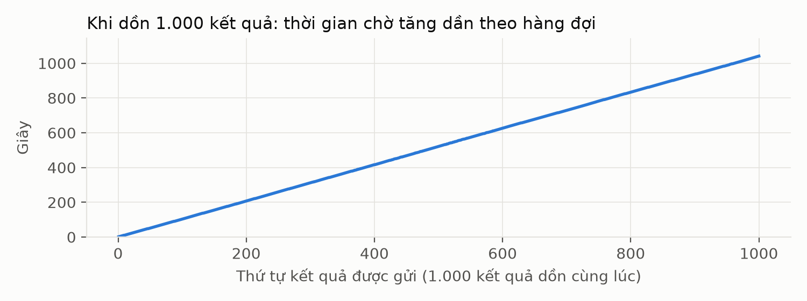
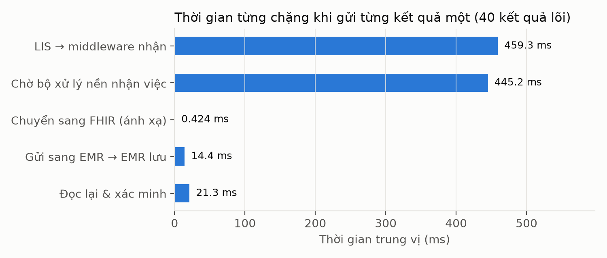

# Báo cáo thực nghiệm sau sửa lỗi LIS → FHIR → EMR

Đợt `2026-11-12-sau-sua-01`. Mã nền `4220045`; bản sửa chưa commit được định danh bằng fingerprint trong `run-manifest.json`.

## 1. Kết quả chính

- Các phép kiểm tra: **70/70 đạt**, 0 không đạt.
- E1: **1000/1000** kết quả khớp bộ đáp án độc lập; đối chiếu **PASS**.
- Đối chiếu theo trường: **24000/24000** phép so sánh MR01–MR09 đúng; 0 sai, 0 chưa xác minh.
- FHIR M8: **1000/1000** file không có error/fatal; tổng error/fatal: **0**.
- E2: dữ liệu sai bị báo DELIVERED = **0**; bản ghi sai lọt vào EMR = **0**.
- Cấu hình polling, retry, timeout và số tiến trình giữ nguyên. Đợt này không tối ưu hiệu năng.

## 2. So sánh trực tiếp trước–sau

| Phép kiểm tra | Trước sửa (11/11) | Sau sửa | Kết luận sau sửa |
|---|---|---|---|
| `TC03-MW-1` — mã lạ vào middleware | KHÔNG bị chặn (middleware: DELIVERED), EMR lưu 1 bản ghi | bị chặn ngay ở middleware (HTTP 422), EMR lưu 0 bản ghi | DAT |
| `TC03-MW-2` — đơn vị sai vào middleware | KHÔNG bị chặn (middleware: DELIVERED), EMR lưu 1 bản ghi | bị chặn ngay ở middleware (HTTP 422), EMR lưu 0 bản ghi | DAT |
| `TC03-EMR-7` — mã lạ vào EMR | HTTP 201, EMR lưu 1 bản ghi | HTTP 422, EMR lưu 0 bản ghi | DAT |
| `E2-TONG-1` — số ca báo hoàn tất sai | 2 | 0 | DAT |
| `E2-TONG-2` — số bản ghi sai ở EMR | 3 | 0 | DAT |
| `FHIR-M8` — số Observation đạt / 1000 | 0 | 1000 | DAT |
| `TC03-EMR-9` — đơn vị sai nhưng nhất quán | Chưa có ca này | HTTP 422, EMR lưu 0 bản ghi | DAT |
| `TC03-EMR-10` — đơn vị sai, không có cận | Chưa có ca này | HTTP 422, EMR lưu 0 bản ghi | DAT |

Đợt cũ có 67 phép kiểm tra; đợt mới có 70. Hai ca E2 bổ sung kiểm tra đơn vị sai nhưng nhất quán và đơn vị sai không có cận; một phép thử validator trên một file được thêm trước bước 1000 file. Không dùng tỷ lệ tổng để thay thế việc so sánh từng ca tương ứng.

## 3. Những thay đổi đã kiểm chứng

- Middleware kiểm tra mã/đơn vị sau kiểm tra cấu trúc và hash. EMR kiểm tra trước khi liên kết bệnh nhân và ghi dữ liệu. Không cấp quyền đọc chéo schema.
- Policy có đúng năm cặp mã–đơn vị, được kiểm tra khớp seed; không đổi mã, chuyển đơn vị hoặc sửa snapshot.
- Mapper dùng `lis-observation-v2`. Namespace URN thống nhất giữa mapper, EMR, patient links, monitor và frontend; namespace không phụ thuộc địa chỉ giao diện localhost.
- Bộ đáp án v3 thay đúng năm cột namespace từ v2; 1000 đáp án lâm sàng được kiểm tra lại với raw MIMIC và seed. Bộ v2 và minh chứng cũ giữ nguyên.
- Ghi kiểm tra sử dụng cùng khóa `flock` cho lọc/thay và append. Test đồng thời xác nhận không mất dòng và chạy lại không nhân đôi.
- Parser nhận TAP/spec; tiến trình test lỗi hoặc không chạy test không được PASS. Bước đóng gói dùng `PACK_GIT=0`.

## 4. Các kịch bản hồi quy và số đo

| Kịch bản | Số phép đạt / tổng |
|---|---|
| PRE | 1/1 |
| E1 | 13/13 |
| E2 | 21/21 |
| E3 | 15/15 |
| E1A | 2/2 |
| E4 | 12/12 |
| AUTO | 4/4 |
| FHIR | 2/2 |

E4b hết ngân sách retry rồi FAILED là hành vi đúng thiết kế, không phải lỗi mới. E4c kiểm tra đường đưa lại thủ công; các điều kiện chống trùng và không báo hoàn tất sai được giữ nguyên. TC06/TC07 tiếp tục có bằng chứng từ test tự động.

| Chỉ số thời gian | Trước sửa | Sau sửa |
|---|---|---|
| E1 dồn 1000, đầu–cuối | trung vị 525208.800 ms; p95 998954.700 ms | trung vị 521254.000 ms; p95 987599.400 ms |
| E1 dồn 1000, ánh xạ | trung vị 0.723 ms; p95 1.267 ms | trung vị 0.329 ms; p95 0.563 ms |
| E1A từng kết quả, đầu–cuối | trung vị 965.600 ms; p95 1870.300 ms | trung vị 901.700 ms; p95 1914.300 ms |
| E1A từng kết quả, ánh xạ | trung vị 0.675 ms; p95 0.985 ms | trung vị 0.424 ms; p95 0.747 ms |

Thời gian là số mô tả của từng đợt trên một máy. Không đặt ngưỡng hiệu năng mới và không kết luận tối ưu do đợt sửa này.





## 5. Kiểm thử và kiểm tra trình duyệt

```text
Tổng số test: 522
Đạt: 522
Không đạt: 0
Bỏ qua: 0
Mã thoát: 0
```

- Test SPP82: 114/114; ops: 13/13.
- Test frontend ba workspace: 92/92. Backend TypeScript, frontend check/build: PASS.
- Test hồi quy trên mã nền và mã đã sửa được lưu riêng, chứng minh các ca mới phát hiện hành vi sai trước khi sửa.
- Kiểm tra Chrome với API thực: tìm theo mã bệnh nhân, đọc kết quả EMR, 9 trường hiển thị khớp, receipt STORED trên cả ba entrypoint. Chỉ gửi GET; ảnh và danh sách HTTP nằm trong `kiem-tra-trinh-duyet/`.

## 6. Môi trường, khả năng tái kiểm tra và giới hạn

- Reference: `v3`, rules `spp82-independent-mr01-mr09-v2`, SHA-256 manifest `5d7da4f5767be864a75a459f3c1c6d52cdc84f44fa76824a3c5aaf70616fcaae`.
- Source tree SHA-256: `0a816c58f21f70f8f6440a3f80b1e56b7d129f24b5b4c1278a53f858614b45bd`. Không tạo commit hoặc push trong phiên này.
- Cấu hình mặc định: HTTP timeout 3000 ms, lease 15000 ms, polling 1000 ms; retry sau 2000/4000/8000 ms, 4 lần thử; 1 dispatcher và 1 worker. E4c dùng tạm ngân sách 7 lần để đưa lại, rồi khôi phục mặc định, giống protocol đợt cũ.
- HL7 validator 7.0.5, FHIR R4 4.0.1; terminology mặc định như đợt cũ. SHA-256 JAR nằm trong `kiem-tra-fhir/validator-jar.sha256`.
- Validator trả 1000 kết quả file; có 4000 lượt warning. Warning không được xóa hay đổi mức; tiêu chí M8 vẫn là không có error/fatal.
- Một máy, một đợt chạy; dữ liệu MIMIC đã khử định danh, ngày 21xx, FINAL và UTC là giả định mô phỏng. Mã/đơn vị vẫn là hợp đồng cục bộ; chưa tuyên bố LOINC/UCUM hoặc đánh giá lâm sàng đầy đủ.
- Đợt mới chạy trên lisexp sạch. Không di trú DB demo cũ và không ghi đè FHIR/hash đã lưu. Trạng thái demo trước khi chạy được ghi trong nhật ký.

## 7. Minh chứng

| Đường dẫn tương đối | Nội dung |
|---|---|
| `kiem-tra.jsonl` | Kỳ vọng, thực tế, kết luận từng ca |
| `run-manifest.json` | Fingerprint mã nguồn, cấu hình và oracle |
| `TONG_HOP_SO_LIEU.md`, `chi-so.json` | Chỉ số và mẫu số tự sinh |
| `E1-1000-ket-qua/doi-chieu/` | Kết quả đối chiếu độc lập theo kết quả và trường |
| `E2-sai-benh-nhan-du-lieu-sai/` | Gói tin, HTTP, trạng thái và số hàng sai ở EMR |
| `E3-gui-trung/`, `E4-gian-doan/` | Chống trùng, gián đoạn và requeue |
| `kiem-tra-fhir/` | Kết quả validator, warning, phiên bản và checksum JAR |
| `kiem-thu-ban-sua/` | Log test, hồi quy mã cũ và xác nhận dữ liệu được bảo vệ |
| `kiem-tra-trinh-duyet/` | Báo cáo Chrome, ảnh và HTTP GET thực |
| `MINH_CHUNG_SHA256.txt` | Kiểm tra tính nguyên vẹn sau đóng gói |

Kiểm tra lại: chạy `sha256sum -c MINH_CHUNG_SHA256.txt` trong thư mục đợt này. File thô lớn được nén gzip; nội dung giải nén giữ nguyên.
